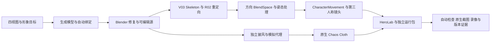
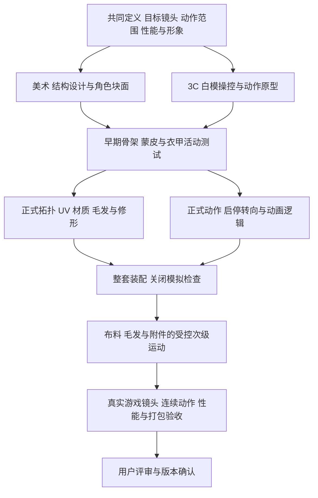

# 从概念原画到可操纵主角：本工程复盘与高质量角色生产路线

编写日期：2026-10-25，Asia/Shanghai。复盘对象：`Frontier3C.uproject`，UE **5.7.4 / CL51494982**，截至候选 **v0.3-rc1 / `df04e31ec1aca95e77436ae1a6476af6cf61269c`**。

这篇文档回答三个问题：我们实际怎样从四视图走到了可操纵角色；公开的高质量游戏生产资料怎样安排美术、绑定、动画和3C；后续应保留哪些成果、停止哪些补丁式投入、按什么顺序补齐生产条件。

> 公开版阅读说明：本目录仅发布流程文档。文内“本地工程”路径用于定位原工程中的源资产、代码和验证证据，相关文件及截图未随文发布；外部链接指向公开资料。版本、测试结果和资料核查日期均保留原记录，不表示在本文上传时重新验收。

## 1. 对当前成果的准确定位

本工程已经打通了“概念参考 → 三维源资产 → 骨架和动作 → 引擎角色 → 镜头与操控 → 可重复验证和打包”的技术链路。它是一份值得保存的**可玩技术原型与工具基线**，还不是生产级主角美术成品。

用户本次指出的三类问题——**披风与盔甲间有缝隙、披风下的模型穿插、肩甲与皮毛等部件像粘在一起**——应作为当前未关闭的视觉缺陷。上一轮测试通过，不能将这些反馈归为已经验收后的“额外要求”。此前“修正姿态”和“当前截图复核通过”的结论，范围只能限于当时检查的关节、动作和画面；不能扩展为整套衣甲结构、所有动态姿态和最终美术都正确。

本项目最需要修正的生产顺序是：**先确认角色各层是什么、怎样连接和怎样运动，再让这些层产生次级物理；动画、控制器和镜头则应从早期就并行验证。** 提高布料求解精度不能补出服装结构，也不能替代硬甲绑定与皮毛制作。

正式基线仍是用户已接受的 v0.1；v0.2-rc1、v0.3-rc1 都不能因自动检查通过而自动晋升正式版。本次只整理流程和路线，不修改运行资产，不迁移 MongolSteppe，也不改写已有发布证据。

### 1.1 本文怎样区分事实与判断

| 标记 | 含义 | 例子 |
|---|---|---|
| 工程事实 | 可由源文件、代码、Git 或报告核对 | 活动动画为 V03/R02；披风实际运行 Chaos 粒子 |
| 用户反馈 | 当前应处理的外观或操控问题 | 缝隙、穿模、肩甲与皮毛粘连 |
| 公开制作事实 | 开发商、制作人员或工具厂商直接公开的内容 | 顽皮狗的动画原型流程；Larian 的装备制作规范 |
| 工程分析／建议 | 综合以上证据提出的解释或未来做法 | 先做衣甲分层与关闭模拟的装配检查，再调整披风 |

公开资料通常只覆盖一个项目、一个部门或一次演讲，不存在所有3A游戏都遵循的唯一工序表。下文的生产路线是为本角色综合出的建议，不冒充某家工作室的内部标准。资料中只有摘要可读的地方，按摘要使用，不声称已经观看完整演讲。

## 2. 我们实际走过的流程

### 2.1 起点：有视觉目标，没有完整的生产设计

`Producer_Ref/front.jpg`、`back.jpg`、`left.jpg`、`right.jpg` 提供了成年男性、长黑发与胡须、藏蓝衣料、皮革、甲片、毛领和长披风的形象目标。它们能约束身份和轮廓，但并不等同于完整角色制作包：遮挡处怎样闭合、披风如何固定、肩甲能转多少、毛皮底座和长毛怎样分层，仍然需要设计。

初期确定了 186 cm 的角色尺度、UE 5.7.4、第三人称全身移动与过肩聚焦。这个技术框架有价值；不足是服装结构和动作范围没有同时成为强制通过的源资产条件。美术基线（本地工程：`Docs/art-direction-brief.md`，未随文发布）

### 2.2 从 V01 到 V03 的实际演进

| 阶段 | 实际做法与思路 | 获得的效果 | 留下的问题或代价 |
|---|---|---|---|
| 四视图转三维 | Tripo 多视图生成、格式转换和自动绑定；保留服务结果与来源 | 快速得到轮廓、面部辨识、服装外观和可导入模型 | 生成结果不是已完成分件、拓扑、隐藏面、材质语义和形变设计的成品 |
| DCC 整理与导入 | Blender 修复骨架和单位；厘米数据、单位根缩放；FBX 导入 UE | 解决尺度、方向、骨架与引擎资源的连接问题 | 自动关节中心和轴向当时没有完成充分的解剖与动作压力检查 |
| V01 可玩基线 | 模板动作离线重定向；CharacterMovement、Enhanced Input、SpringArm；独立演示场景 | 主角能前后左右移动、跑、慢走、聚焦、换肩和避墙 | 模板动作与自动蒙皮尚不能保证衣甲、手掌和重心可信 |
| V01 固化 | Git/LFS、14 项基础检查、截图、独立包 | 获得可回滚的正式基线 `4b4581d…` | 基础检查主要证明能运行和能操控 |
| V02 运动与外观迭代 | 保留原 22 身体骨，增加 9 披风骨；地形双骨 IK、身体惯性、骨链披风；材质和场景整理 | 接地对照、镜头／输入接管、次级运动和展示得到改善 | 继续沿用后来确认为不合理的身体参考结构；骨链摆动不等于长披风布料；肩髋与掌向问题继续存在 |
| V03 解剖修复 | 明确允许修改关节位置、参考变换、肢体轴和掌向；独立 32 骨 Skeleton；新 R02 重定向结果 | 对源头问题进行修复，避免只靠动画偏移掩盖；姿态检查扩展到 28 阶段 | 这是解剖与目标动作范围的修复，不等于全套生产级绑定、手指／面部和修形完成 |
| V03 披风分离 | 从旧模型中提取披风，建立独立显示／模拟网格和原生 Cloth Asset／Component | 披风确实具有独立的物理响应 | 披风分离后暴露背部、侧缝和腋侧结构不足，必须回到源模型补面 |
| V03 补面与布料迭代 | 新增藏蓝内衣壳、局部衣褶和头发孔洞修补；修正法线／绕序／映射；反复比较代理、约束和预算 | 能持续跑、停、折返；保留可编辑源与往返审计 | 原外观资产越需要完整保留，局部结构修复越容易变成补丁叠加；最终衣甲层间关系仍未完整验收 |
| V03 证据固化 | 14／24／34 项分层检查、原生 Trace、连续录像、真实时间测量、打包与哈希绑定 | 能说明运行的是哪份资产、测了什么，避免旧结果混用 | 用户后来指出的接缝与穿插说明，测量覆盖面和视觉验收仍有缺口 |

版本依据见 版本记录（本地工程：`Docs/版本记录.md`，未随文发布）、V02 阶段验收（本地工程：`Docs/v0.2阶段验收.md`，未随文发布）、V03 姿态及布料记录（本地工程：`Docs/v0.3姿态与布料验收.md`，未随文发布）。

### 2.3 当前技术链路的落点

主要落盘位置：

| 产物 | 位置与作用 |
|---|---|
| 可编辑身体与骨架 | `ArtSource/HeroV03/Hero_Rig_V03.blend`、`SK_Hero_V03.fbx` |
| 披风源与参数 | `ArtSource/HeroV03/Cloth/Cape_Source.blend`、`cape-chaos.json`、`cape-coarse-multires.json` |
| 来源及往返检查 | `ArtSource/HeroV03/History`、`UnderarmCandidate`、`Cloth/final-source-audit.json` |
| 活动角色配置 | `Content/Hero/DA_Hero.uasset` |
| 活动动作 | `Content/Hero/V03/Animations/R02/Directional` |
| 角色、输入、镜头 | `Source/Frontier3C/FrontierCharacter.cpp`、`HeroPresentation.h` |
| 动画与接地 | `Source/Frontier3C/HeroAnimInstance.cpp` |
| UE 离线资产工具 | `Source/Frontier3CEditor`、`Scripts/import_hero_v03.py`、`build_cape_v03.py` |
| 冻结证据与录像 | Releases/v0.3（本地工程：`Releases/v0.3`，未随文发布）、发布清单（本地工程：`Releases/v0.3/release.json`，未随文发布）、动态录像（本地工程：`Releases/v0.3/cloth-motion.mp4`，未随文发布） |
| 候选独立包 | `Builds/v0.3-rc1/Windows`；默认演示包为 `Builds/Windows` |

## 3. 公开的真实项目给出了什么证据

### 3.1 角色制作是多个专业交接，不是生成一次模型后逐项打开引擎功能

Larian 公开列出的角色流程包含概念、高模、重拓扑／UV、贴图、编辑器检查、绑定、蒙皮和动画；同一文档还单独规范关节布线、装备切分与遮盖。它描述的是其项目和工具，顺序甚至包含绑定前的引擎检查，说明实际生产允许多次往返，而不是一次走到底。[S01：Larian 角色制作规范](https://docs.larian.game/My_first:_Character)

《神秘海域2》的 GDC 官方摘要明确区分雕刻、游戏网格、高分辨率细节采样、UV 接缝及面部绑定，并介绍通过 Maya 引用管理不同服装的共同骨架。它是历史实例，不应照搬其参数，但能直接证明“原画外观、运行网格和变形系统”并不是同一份工作的自动结果。[S12：Richard Diamant／Judd Simantov，GDC 2010](https://www.gdcvault.com/play/1012798/Uncharted-2-Character-Pipeline-An)

更具体的已发售资产例子是《最后生还者 Part I》的 David。角色艺术家 Colleen Larson 在本人项目页中分别列出服装雕刻与低模、头部雕刻与 blendshapes、多轮贴图、头发／胡须，以及配合设计制作剧情损伤的参与者。这里可以核实的是实际分工与多轮交接，不是把多人名单换算成本项目的固定人数或工期。[S13：作者项目页](https://colleen.artstation.com/projects/14vWxX)

《最后生还者 Part II》的角色技术演讲摘要强调频繁评审、持续试玩，以及支持非破坏式、由美术人员主导的作者工具。这支持我们保留源文件、自动构建和版本证据的方向；也提醒我们，工具应缩短美术反馈回路，而不应让大部分精力围绕证明工具自身已经运行。[S02：Wasim Khan，GDC 2021](https://www.gdcvault.com/play/1027376/Character-Technology-of-The-Last)

### 3.2 动画与设计应早期并行，动捕也需要制作和清理

顽皮狗对《神秘海域4》动画流程的官方介绍包括预演、动捕、过渡、资产追踪和反馈，并明确介绍通过动画原型帮助设计和程序做决策。我们先使用模板人或临时主角建立操控，是合理的原型路径；不合理的是把它直接当作最终角色的动作和形变验收。[S03：Naughty Dog at GDC 2017](https://www.naughtydog.com/blog/naughty_dog_gdc_2017)

顽皮狗《最后生还者》官方播客文字稿中，制作人员谈到重新制作移动系统、Motion Matching，以及动画师对动捕数据的大量处理。动作来源只是输入，能够自然地启停、转身、接触和表达角色性格，仍是动画生产工作。[S04：官方播客 Episode 5](https://www.naughtydog.com/podcasts/thelastofus/en/ep-05)

### 3.3 “真实物理”也要服从可控的表演和预算

顽皮狗在同一 GDC 2017 官方介绍中回顾，《神秘海域4》在玩法动画上叠加物理的初期效果很差，后来才改善为更可预期、具有艺术控制的动画驱动。它说明物理和手工设计是配合关系，不能推导出“越接近未经控制的真实物理越高级”。[S03](https://www.naughtydog.com/blog/naughty_dog_gdc_2017)

Epic 的 Panel Cloth 工作流先要求在 DCC 中让服装合身，并准备显示／模拟网格，再做权重、约束、碰撞和游戏内测试。我们后半段所做的原生组件、代理和验证符合这个方向，但前置的服装结构与合身检查不足，导致顺序倒置。[S05：UE 5.7 Panel Cloth](https://dev.epicgames.com/documentation/en-us/unreal-engine/panel-cloth-editor-overview?application_version=5.7)

### 3.4 头发和近景质量有自己的制作与评审过程

《地平线 Zero Dawn》头发作者 Johan Lithvall 的项目页直接记录其与代码、绑定和着色人员协作完成 Aloy 动态头发。它证明毛发外观、运动和成本需要一起制作，不证明每件毛领都要用同一套技术或相同预算。[S14：作者项目页](https://lithvall.artstation.com/projects/EDbk4)

Guerrilla 在2023年的《Horizon Forbidden West》脸部制作资料页中，将真实感、开放世界角色质量一致性与 lookdev 单独讨论，并以摄影测量照片作为外观验证工具的例子。我们可以借鉴“用真实参考和特定视角专项评审”的方法，不能只凭该摘要声称已还原其全部头部生产流程。[S15：Guerrilla／Arno Schmitz](https://www.guerrilla-games.com/read/creating-the-many-faces-of-horizon-forbidden-west)

## 4. 面向本角色的建议生产路线

以下是结合公开资料与本工程问题整理的路线。它不是“先把所有美术做完，再写程序”，而是两条并行线通过明确的交付物汇合。

### 4.1 每个环节的输入、先后与应该产生的效果

| 顺序／并行关系 | 工作与交付物 | 完成后应看到什么 | 为什么必须在这里检查 |
|---|---|---|---|
| 0：共同起点 | 目标平台、镜头远近、动作清单、角色性格、画质与帧时间预算 | 清楚哪些细节要近看、哪些姿态一定会出现 | 决定建模、动作、毛发和物理投入，避免没有边界的“做到3A” |
| 1A：美术 | 参考研究、比例表、材质表、服装爆炸图、背面／内侧与固定方式补充设计 | 角色身份统一，衣物和装备能在空间中装配 | 四视图未解释的结构必须有人做设计判断 |
| 1B：与1A并行 | 模板人／白模、胶囊、镜头、输入、加减速和转向原型 | 在简单场景内先判断跟手、视野、角色尺度与关卡尺度 | 不必等待精细模型，避免靠昂贵美术修补操控问题 |
| 2：块面阶段 | 人体与服装块面、甲片厚度、皮毛底座、披风固定区；早期骨架 | 灰材质下轮廓成立，抬臂／扭身时各层有空间 | 最便宜的时候发现关节中心和衣甲活动范围错误 |
| 3：结构与形变确认后 | 高模／扫描或重用资产整理；生产拓扑、UV、材质ID与烘焙测试 | 大体积、接缝、厚度和关节布线可控 | 不应先精绘一套随后必须大改拓扑的贴图 |
| 4A：材质与外观 | 分材质 lookdev，烘焙、PBR、皮肤／眼睛／金属／布料／毛发策略 | 中性光与实际场景下都能读出材质差异 | 美术细节不应只能在一套暖光里成立 |
| 4B：与4A反复协作 | 正式骨架、蒙皮、甲片控制、必要修形、手指和表情需求 | 身体有体积，甲片不融化，关节不塌，服装不被错误肢体拖走 | 绑定要对真实结构负责，而不是只让骨架动起来 |
| 4C：与4A／4B并行 | 动捕／动作库清理、重定向、角色化调整、启停转向和接触动作 | 连续动作有重心，速度和脚步匹配，状态切换可读 | 模板循环与自动重定向只解决部分数据接入 |
| 5：整套角色汇合 | 关闭物理的服装装配与动作压力测试，检查遮盖和接缝 | 不依靠随机摆动也能保持结构正确 | 先隔离骨架／蒙皮错误，防止用物理掩盖源问题 |
| 6：装配合格后 | 披风／饰物／毛发的次级运动，碰撞、阻尼、固定区与切换策略 | 运动有延迟和回落，接触合理，轮廓可控 | 次级运动增加可信度，不能承担主要结构修复 |
| 7：贯穿生产，末期收敛 | 各类LOD、材质／纹理／骨骼／布料预算、CPU/GPU与内存测量 | 在目标设备和真实场景中保持约定的画质与响应 | 预算不能拖到角色完成后才第一次测量 |
| 8：版本门槛 | 连续实机录像、技术检查、人工逐项评审、打包、来源与版本冻结 | 能复现同一质量，并知道哪些内容尚未验收 | 最终看的是玩家操纵中的整体，不是单张渲染或通过数量 |

高模到低模烘焙是本角色适用的一条常见路线，不是所有项目的强制形式。Adobe 的官方工作流明确区分显示用网格、细节来源与投射笼，并要求检查烘焙交叉和日志；关键是可控的几何与材质数据，而不是软件名称或面数大小。[S06：Adobe 烘焙工作流](https://experienceleague.adobe.com/en/docs/substance-3d-painter/using/baking/how-to-bake-mesh-maps)

## 5. 本角色最缺少的是“各部件怎样运动”的明确设计

下面这张表应先于下一轮美术制作落实。它是本项目建议，不能将每一行理解为必须增加一个运行组件。

| 部件 | 源资产必须能明确识别的内容 | 主要运动职责 | 验收重点 |
|---|---|---|---|
| 人体与贴身衣物 | 解剖体积、关节区拓扑、可见／隐藏区域、蒙皮边界 | 身体骨架、连续蒙皮，必要时纠正形变 | 肩髋体积、肘膝弯曲、掌向、抬臂与下蹲 |
| 胸甲、肩甲、甲片 | 各块硬片边界、厚度、旋转轴、连接带和活动间隙 | 主要保持刚性；必要的辅助骨、约束或联动 | 不应像皮肤一样拉长；抬臂时不切入颈胸与毛领 |
| 皮革带与软裙甲 | 哪部分固定、哪部分弯曲，软硬材质分区 | 受控蒙皮／辅助骨／修形，按需要添加次级运动 | 不随无关大腿横穿身体；扣具仍保持硬形 |
| 毛领／皮毛 | 皮革或布料底座与毛束的关系，毛流、轮廓和LOD | 底座跟随服装结构；毛束用发片、网格或Groom等合适方案 | 与肩甲有空间和遮盖关系，避免整团像实体塑料块 |
| 披风 | 上沿固定方式、里外表面、厚度表达、覆盖量、显示／模拟网格 | 固定区随正确锚点；自由区做受控布料运动 | 接缝不露底，固定区与上方服装不会各走各的 |
| 头发、胡须 | 发际线、发束、材质与绑定／LOD | 合适的网格、发片或束发方案，按预算添加运动 | 近景轮廓、阴影、脖颈接触和运动稳定性 |

Autodesk 将盔甲列为适合刚性绑定的部件示例：其目的在于保持网格和骨架之间的固定关系。这不意味着全套铠甲都绑在同一根骨上；每块板甲的轴心与联动仍需要设计。[S07：Maya Rigid skinning](https://help.autodesk.com/cloudhelp/2025/ENU/Maya-CharacterAnimation/files/GUID-30415E88-797A-424E-95C5-8EDC79B25614.htm)

同样，毛领不必为了“前沿”一律改成高成本发丝。Epic 的 Groom 文档同时讨论卡片、发丝和网格LOD，并说明毛发造型应在 DCC 完成。选择依据是镜头、轮廓、运动和预算。[S08：UE 5.7 Groom](https://dev.epicgames.com/documentation/en-us/unreal-engine/groom-components-and-assets-in-unreal-engine?application_version=5.7)

**一个 Skeletal Mesh、一个材质槽、一个连通表面、一个运动单元，是四件不同的事。** 逻辑分件不要求每件都增加组件或 draw call；多个部分可以为运行效率合并输出，但源文件中必须保留可选择、可赋权、可修形的边界。反过来，拆成多个组件也不会自动得到合理结构。

### 5.1 材质细节不能替代体积、结构与形变

原生成角色的外观纹理、新增衣料材质、法线微细节和哑光响应都可以继续利用，但需要区分三种修复：法线／粗糙度改善光照下的表面读法，几何解决真实轮廓与厚度，蒙皮／修形决定动作中的体积。给肩甲增加法线细节，不能修复它被拉软；给接缝涂暗色，也不能在所有镜头下补出缺失的搭接。

PBR 的材质输入应与环境照明分离。Google Filament 的材质技术文档明确规定 Base Color 不应包含照明信息，微遮蔽另有说明。因此，本工程仍需检查原纹理是否带有过重的固定阴影或高光，而不能以文件名是 BaseColor／Normal／Roughness／Metallic 就认定材质完成。这里指出的是待检风险，不是已经逐像素证明原图违反规范。[S16：Filament 材质制作](https://google.github.io/filament/main/filament.html)

## 6. 当前三类问题应怎样定位

### 6.1 披风与盔甲之间的缝隙

这是用户已指出的缺陷，但本文没有完成新的逐帧 DCC 检查，不能把它唯一归因为“碰撞厚度过大”。应按下面的诊断顺序处理：

1. **关闭模拟，检查参考姿态和装配。** 上沿是否已经离开毛领／盔甲，是否缺少领口、衬层、搭接或缝合结构？静态就有缝，应先修源结构。
2. **仍关闭模拟，播放抬臂、扭身与转向。** 上方衣甲与披风固定边是否由不同的骨或权重带走？若此时出现缝，应修绑定和固定区关系。
3. **开启模拟，对照同一动作。** 若只在模拟后分离，再查固定遮罩、显示到模拟的映射、接触偏移、碰撞厚度和动画驱动。

源码可以确认：披风显示和模拟源中使用了 `spine_02` 权重，运行时又通过 LeaderPose 跟随身体骨架。这个选择可作为胸背固定披风的起点，但它本身不能证明肩甲、毛领和披风上沿在各种肩部动作下仍匹配。披风提取（本地工程：`Scripts/prepare_cape_v03.py`，未随文发布）、角色组件（本地工程：`Source/Frontier3C/FrontierCharacter.cpp`，未随文发布）

正确目标不是把所有表面推到“看起来碰不到”的距离。通常需要设计合理搭接、边界覆盖和运动余量；可隐藏的内部结构与玩家可见的分离，要分别判断。Larian 的装备规范就明确要求服装片之间不互穿、分界处得到遮盖。[S01](https://docs.larian.game/My_first:_Character)

### 6.2 披风下的模型穿模

应先分清哪两层相穿，而不是统称为“布料问题”：

| 相交双方 | 更可能需要检查的责任环节 | 单独增加披风迭代不能解决什么 |
|---|---|---|
| 身体／内衣与甲片 | 造型空间、身体隐藏策略、蒙皮、甲片刚性、必要修形 | 错误权重和错误层次 |
| 甲片与甲片／毛皮底座 | 分件结构、轴心、辅助骨、动作范围 | 两块本就没有独立运动职责的部件 |
| 披风与身体／装备 | 固定区、碰撞代理覆盖、厚度、显示映射、求解预算 | 根本没被代理覆盖到的突出肩甲／腰部附件 |
| 披风显示三角形与其他面 | 显示网格、映射、采样覆盖和最终画面 | 检查模拟动态粒子点，而非最终显示表面，不能证明整个面没有穿过物体 |

我们已经证实，旧披风遮住过不完整的背部和侧缝；后来补内衣壳是必要修复，但它出现在物理实施之后。新的内衣壳仍需与外层甲片一起做完整动作评审，不能只以“补面成功、原UV未改”结束。V03 源说明（本地工程：`ArtSource/HeroV03/README.md`，未随文发布）

完整保留一套被衣甲盖住的人体，并不是所有游戏都采用的唯一正确做法。Larian 的装备系统会隐藏对应身体部位。本项目应决定哪些区域永不外露、哪些在披风摆开或动作时会显露，再选择隐藏、裁切、重建或遮盖；不能为减少穿模任意删掉下一帧会被看到的表面。[S01](https://docs.larian.game/My_first:_Character)

### 6.3 肩甲、皮毛等部件像粘在一起

这是当前可见效果问题，不足以直接证明所有部件在拓扑上都已焊接。几何相连、权重相同、缺乏活动关节、没有厚度与重叠层次、法线或贴图把分界抹平，都可能产生类似外观。

下一步应在源文件中用部件选择、连通域、材质／顶点组和权重显示确认原因。如果硬甲主要被连续皮肤权重拉伸，优先处理硬片控制；如果皮毛本身只是实体块的外观纹理，优先处理底座和毛束表达。不能期待一个披风组件同时完成这两项生产工作。

本轮明确保留了原 M0 的身份几何、UV 等数据，再新增 M1 衣料。这对回滚和形象延续有价值，但也限制了对原肩甲、毛领和纹理结构的深度重做。后续应采用新的生产资产修订，保留旧版本，允许对确定有问题的局部进行有依据的重拓扑、分件和重烘焙；保留历史不等于永远冻结错误结构。

### 6.4 当前截图能说明什么

**本地截图（未随文发布）：** 候选包侧面，能观察披风上沿、肩甲与内衬关系；路径：`Releases/v0.3/posture-idle-side-packaged-60fps.png`。

图1：候选包实际引擎侧面画面。它记录当前结果，可帮助定位上沿、内衬和层次问题；不以这一个角度证明全部动态接触正确。

**本地截图（未随文发布）：** 候选包近景，观察肩甲、毛领及腋侧材质和层次；路径：`Releases/v0.3/quality-portrait-packaged-60fps.png`。

图2：候选包实际近景。肩甲、皮毛、衣料的制作和动态职责必须分别评审。截图中的暖光展示不能替代中性光、线框／权重视图和连续动作。

## 7. 3C 与动画：现有路线哪里合理，哪里尚未完成

本文将3C理解为角色、控制和镜头之间的共同设计，而不是一个可独立安装后完成所有手感的插件。

现有基线是清楚的：CharacterMovement 管位移、胶囊体与地形移动；Enhanced Input 管动作输入；SpringArm 和相机逻辑管环绕、聚焦、换肩与墙体回缩；方向 BlendSpace、离线重定向和 `UHeroAnimInstance` 管姿态。主工程接管镜头和输入的接口也已做过检查。这些能力应继续保留。

175／460／95 cm/s 的走跑慢走、350 cm 的镜头臂和 68° 默认 FOV，是本工程的设计参数，不是测量自《神秘海域》或《最后生还者》的行业正确值。它们应在实际关卡、角色尺寸和目标操控感中评审。[本地：早期范围与控制设计](从原画到可玩主角_Plan.md)

还缺少的关键生产内容包括：起步、停止、180° 转身、步态与速度转换、聚焦侧移／后退过渡、脚的支撑与离地时机、角色化重心，以及与服装同时进行的动作清理。模板循环加腰背倾斜，不能替代这些动作。

| 技术 | 主要解决什么 | 不能代替什么 |
|---|---|---|
| 重定向 | 把源动画适配到目标骨架与比例 | 正确解剖、好拓扑、合理衣甲权重 |
| 地形 IK | 根据地形调整肢体末端与姿态 | 全程脚掌锁定、步态节奏和有说服力的重心 |
| 步幅／朝向等 warping | 在一定范围内调整现有动作与运动需求 | 缺失的高质量启停和转向覆盖 |
| Motion Matching | 在动作库中选择适合当前姿态与轨迹的片段 | 生产动作数据、清理接触、修复坏绑定 |
| Root Motion | 提取并使用动画根位移的一种运动组织方式 | 自动获得合理碰撞、镜头和控制响应 |

Epic 的 IK Retargeting 文档将骨链、参考姿态与接触调整分别处理；自动映射成功不等于服装形变合格。[S09：UE 5.7 IK Retargeting](https://dev.epicgames.com/documentation/en-us/unreal-engine/ik-rig-animation-retargeting-in-unreal-engine?application_version=5.7)

Motion Matching 和 Root Motion 也不是同一维度的选项。Epic Game Animation Sample 本身就使用 capsule-driven movement；本项目使用 CharacterMovement 不是因为它“落后”就必须推倒。需要先明确位移权属、动作覆盖与接触标准，再选择动画系统。[S10：UE 5.7 Game Animation Sample](https://dev.epicgames.com/documentation/en-us/unreal-engine/game-animation-sample-project-in-unreal-engine?application_version=5.7)、[S11：Root Motion](https://dev.epicgames.com/documentation/unreal-engine/root-motion-in-unreal-engine?application_version=5.7)

## 8. 应保留的成果，与需要纠正的偏差

| 做法 | 判断 | 后续处理 |
|---|---|---|
| 先打通可玩原型和模板动作 | 合理，能快速验证输入／镜头／尺寸 | 保留为控制回归基线；不要当最终动作完成 |
| 保留概念、源文件、导入资产和来源 | 合理，便于重建与追责 | 保留；补齐语义分件和版本化装配说明 |
| 固定厘米单位、方向和根缩放 | 正确的基础约定 | 继续作为导入硬门槛 |
| 为 V03 修正骨架并新建 Skeleton／重定向目录 | 对源头错误的正确处理 | 保留修复依据；以后更早验证关节与活动范围 |
| 披风显示与模拟分离、使用原生组件和碰撞代理 | 符合可控实时布料的技术方向 | 在服装结构合格后继续复用，不以组件存在证明视觉正确 |
| 一直最大限度保留原始生成几何与UV | 原型期有利于身份和回滚；生产期过度保守 | 已确认错误的结构允许局部或整体替换，旧版留作来源 |
| 用程序补壳、局部褶皱和参数持续补救 | 可解决明确的小缺陷；不能替代整套服装设计 | 先判断是否已经超过局部修补的合理范围 |
| 用外观颜色阈值推断部分材质区域 | 可以作为临时识别手段 | 建立正式材质ID、选区、可编辑贴图层和稳定命名 |
| 在整体结构尚未通过时深挖高级布料配置 | 顺序不经济，减少的是求解问题而非主要资产风险 | 暂停继续追新；先通过分层与无模拟装配门槛 |
| 14／24／34 检查、原生 Trace、独立包和哈希 | 有价值的技术证据 | 保留，但给各检查写清覆盖范围和未覆盖范围 |
| 以通过数量和少量截图结束视觉验收 | 不充分，当前反馈已经证明缺口 | 增加指定失败姿势、整段录像、人工逐项签收 |
| 仅在后期发现实际帧率问题 | 时间点过晚 | 尽早建立真实时间基线，阶段性看慢帧及CPU/GPU分项 |

AI 生成不是问题的充分解释，也不是通行证。扫描、外包、商城或人工资产如果跳过这些门槛，同样会埋下结构与形变问题。真正有用的改进，是把资产来源与最终交付责任分开。

当前原生 Cloth Asset、C++ 构建接口和 MultiRes 是本工程已经验证的一种技术路线，不是每个高质量角色的必经环节。项目记录还明确区分插件与实验路径的成熟度。选择更复杂的方案前，应先证明它相对简单方案解决了哪项视觉问题、节省了什么预算，以及由谁维护；“更前沿”本身不构成采用理由。

## 9. 为什么这轮会耗时很长

用户经历了多次 `continue`，这项交互成本本身就需要改进。仓库没有统一的制作计时台账，不能从续跑次数、文件时间或 Git 日期准确换算人日，也不能给各原因编造耗时百分比。能够从开发链路确认的是以下几类返工。

### 9.1 高成本阶段承接了尚未解决的低层问题

参考骨架错误在可玩基线之后才集中修正；披风分离后才补背部和侧缝；补面后又发现局部外观和层次问题。每次源结构改变都可能牵动导出、导入、动作检查、布料和截图，导致一次“修披风”实际跨越多个专业环节。

改进：在低细节块面阶段做关节、服装分层和压力动作评审。不通过就停在源资产层，不能把返工推到高成本的物理整合之后。

### 9.2 同时改变了太多变量

这一轮涉及解剖、掌向、蒙皮、补壳、材质、披风拓扑、法线、映射、碰撞、求解器、性能和验收工具。目标虽然都与“角色表现”相关，但若没有独立阶段门槛，很容易在解决一个问题时引入另一个，再做整套重验。

改进：一次实验只针对一个明确假设，记录输入版本、变化、预期、局部结果和采用／淘汰结论。视觉实验先确定选区和控制视角，再加细节；求解实验先锁定源拓扑和碰撞代理。

### 9.3 全流程验证过早介入局部探索

引擎启动、导入、打包、截图和多频率验证都有固定成本。重复运行并非全部无效：最终独立包和证据一致性必须检查；但局部参数还在探索时，不应每次都做发布级流程。工程已经有只更新布料、或只更新身体和布料而不覆盖重定向的入口，应继续分清依赖。刷新脚本（本地工程：`Scripts/refresh_hero_v03.py`，未随文发布）

建议采用三层循环：

| 循环 | 适用变化 | 最小验证 |
|---|---|---|
| 源资产循环 | 分件、厚度、拓扑、权重和修形 | DCC 局部视图、绑定压力动作、导出往返；无需每次打包 |
| 引擎局部循环 | 材质、固定区、代理、布料参数、单个动画转换 | 复用测试场景和固定动作片段，比较局部图像与指标 |
| 阶段发布循环 | 已选定的资产修订和运行逻辑 | 三组检查、30/60 Hz、真实时间性能、独立包、录像和证据冻结 |

### 9.4 验收指标逐步变多，但最主要的视觉失败仍没有独立门槛

增加测试是合理的，但“更多技术检查”不能自动收敛为“更好的角色”。当上沿接缝、衣甲互穿和硬片形变没有单独的失败定义时，工程可能在指标上越来越完整，玩家仍然看到同一类问题。

改进：每次用户指出的问题应形成可复现的动作、镜头和截图位置；先证明该问题被修复，再跑防回归。若多轮局部补丁仍不能解决，应回到源结构，而不是继续增加同一求解器的精度。

### 9.5 工具方向：缩短反馈回路，而不是再堆一组功能

保留可编辑源、稳定导入、版本化构建和自动回归。下一步最有价值的工具是部件与权重检查、固定动作的批量预览、资产依赖判断、可复用的编辑器会话和变更日志。是否建立长驻 UE 本地服务，应另做稳定性和版本适配验证；本文不假设当前已有这样的能力。

## 10. 已有检查到底证明了什么

当前披风细层 616 点、粗层 170 点、45 个对应固定点，使用原生 XPBD MultiRes；12 次迭代上限、动态子步上限 12。保留细层 CCD、人体和自碰撞。这些事实说明有真实的布料系统，不说明衣甲表面全部正确。正式源审计（本地工程：`ArtSource/HeroV03/Cloth/final-source-audit.json`，未随文发布）

| 证据 | 可以支持 | 不应外推为 |
|---|---|---|
| 基础14项 | 指定输入、移动、镜头、碰撞、资产与材质加载 | 最终动画、衣甲和角色美术完成 |
| 质量24项 | 测试动作下的接地变化、骨长、粒子固定／伸长、胶囊穿透等 | 显示三角形、全部盔甲和毛皮、所有环境接触都无穿插 |
| 姿态34项／28阶段 | 指定参考与动作中关节、腿平面和掌向等测量 | 未测动作、完整手指／面部、衣甲活动和全部解剖细节都正确 |
| 原生 Trace | 选定粗细层求解路径确实执行 | 当前材料、附件、接缝和性能预算已经合格 |
| 235帧连续录像 | 保存了一段跑停转向的实际显示输出 | 30 fps 的视频等于设备稳定30或60 FPS |
| 真实时间性能 | 某次本机 HeroLab 的实际吞吐和帧耗时 | 主游戏场景、其他设备或长时间运行具有相同性能 |

质量探针的源码明确将人体穿透测量建立在动态布料粒子点与胶囊表面之间；它并没有拿最终衣甲三角面做完整层间相交测试。报告也已经写明这个边界。问题在于实际交付措辞和视觉门槛没有始终与边界保持一致。角色采样实现（本地工程：`Source/Frontier3C/FrontierCharacter.cpp`，未随文发布）、质量报告生成（本地工程：`Source/Frontier3C/HeroQualityProbe.cpp`，未随文发布）

默认线程上限100的冻结样本平均 **38.825 FPS**，但 p95 帧耗时为 **56.406 ms**；较早同配置样本为29.732 FPS。必须保留这种波动，而不是只展示平均值。线程上限16的实验曾测得约101 FPS，但没有按当前规则采用，不能作为默认工程性能；上限也不等于实际并发线程数。后续不能只以平均帧率过线，就宣布满足3A主角的最终运行预算。真实时间报告（本地工程：`Releases/v0.3/realtime-packaged.json`，未随文发布）

## 11. 后续应该按什么顺序继续

以下是新的生产阶段建议，不是已经实施的改动，也不是未经评估的工期承诺。**下一轮优先关掉模拟检查装配，先处理结构与蒙皮，再恢复物理。**

| 阶段门槛 | 主要产物 | 通过条件 | 不通过时回到哪里 |
|---|---|---|---|
| A：缺陷复现与设计补全 | 当前缺陷清单、指定动作／镜头、衣甲爆炸图、固定和遮盖说明 | 每条缝隙／穿插都能复现；关键部件的关系有设计答案 | 概念与服装结构设计 |
| B：源资产生产整理 | 可选择的身体／衣料／甲片／毛领底座／披风；必要重拓扑与UV／烘焙方案 | 关闭物理，参考姿态与基础装配不存在可见开缝；缺失区域有明确处理 | 源模型，不进入求解调参 |
| C：绑定与装配压力测试 | 约定动作集、权重和硬片控制、必要修形 | 抬臂、跨步、下蹲、扭身、转向时关节和层次成立；甲片不变软、披风上沿不分家 | 骨架、权重、辅助骨、修形或装配空间 |
| D：受控次级运动 | 披风／附件的固定区、代理、参数与LOD策略 | 同一动作在关／开模拟时都可解释；开启后增加可信度，不制造主要缺陷 | DCC装配或物理设置，按症状分流 |
| E：角色化移动与镜头 | 清理过的启停转向、走跑切换、聚焦动作、接触与相机方案 | 玩家操作时动作连续、支撑可信，镜头不掩盖问题 | 动画数据与控制参数 |
| F：材质毛发与性能收敛 | 中性光／实景lookdev、选定毛发方案、LOD与CPU/GPU预算 | 近中远景、慢放与正常速度都满足目标；慢帧有解释和预算 | 相应美术或运行系统 |
| G：新候选与迁移决策 | 可复现的独立包、技术报告、视觉评审和版本记录 | 技术与美术两项分别通过，用户明确接受；然后决定主工程接入内容 | 未通过的具体门槛 |

压力动作应包括本游戏确实需要的动作；例如是否加入深蹲、持械、翻越，应由玩法范围决定。先借少量诊断姿势检查形变，并不等于承诺这些玩法已经实现。

一轮小阶段至少交付：**一个明确的源资产修订、一段能复现问题并看到修复的连续画面、一张逐项缺陷表、一份变更与回归记录。** 不再使用没有范围的“这一轮把人物表现完全正确”作为唯一退出条件。

## 12. 需要怎样的协作能力

| 职责 | 应负责的决定 | 自动化适合承担的部分 |
|---|---|---|
| 角色美术／美术指导 | 身份、人体、服装结构、轮廓、材质和毛发表达 | 来源整理、规范检查、重复导出与预览 |
| 绑定／技术美术 | 关节、硬软分区、权重、修形、固定区与碰撞代理 | 选区／权重报告、姿势批处理、资产构建与诊断 |
| 动画／3C设计 | 动作性格、启停转向、接触、操控响应与镜头 | 重定向批处理、参数对照、输入回归与录像 |
| 运行开发与性能 | 位移权属、生命周期、接管接口、预算和平台表现 | 编译、测量、打包、哈希和发布清单 |

这些是职责，不等于必须配四个全职岗位；小团队可以兼任，但不能让某项职责没有人做决定。当前本地 UE、Blender、源文件和脚本足以继续多数结构与验证工作。更好的动作、精细角色／毛发制作和美术判断需要相应生产投入；增加 Skill 不会自动补齐这些资产与决定。

## 13. 后续阅读与证据索引

### 13.1 本项目已有材料

- [早期范围与投入估算](从原画到可玩主角_Plan.md)：82–168人日是特定范围的早期规划估算，**不是本工程已经消耗的工时，也不是经工作室数据核实的行业统一报价**。
- 角色美术基线（本地工程：`Docs/art-direction-brief.md`，未随文发布）：身份、尺度、方向、材质与镜头约定；其早期状态描述需结合后续修订阅读。
- V02 阶段记录（本地工程：`Docs/v0.2阶段验收.md`，未随文发布）、V03 技术记录（本地工程：`Docs/v0.3姿态与布料验收.md`，未随文发布）、原生布料构建（本地工程：`Docs/v0.3-ChaosCloth原生构建.md`，未随文发布）：保留技术事实，不能代替本次用户反馈后的视觉问题清单。
- V03 身体源说明（本地工程：`ArtSource/HeroV03/README.md`，未随文发布）、布料源说明（本地工程：`ArtSource/HeroV03/Cloth/README.md`，未随文发布）：重建入口、几何与来源限制。
- 版本记录（本地工程：`Docs/版本记录.md`，未随文发布）、候选发布清单（本地工程：`Releases/v0.3/release.json`，未随文发布）：区分正式基线、候选版本与已记录的测试范围。

### 13.2 一手公开资料

以下资料于2026-10-25核查。开发商材料用于证明真实项目实践；工具文档用于说明相应工具的职责，不将 UE 的实现冒充顽皮狗的引擎实现。

| 编号 | 作者／机构与资料 | 本文使用范围与边界 |
|---|---|---|
| S01 | [Larian Studios：My first: Character](https://docs.larian.game/My_first:_Character) | 角色工序、关节布线、衣甲切分、接缝覆盖和身体隐藏；其历史引擎格式、顶点限制与参数不照搬UE |
| S02 | [Wasim Khan／Naughty Dog，GDC 2021：Character Technology of The Last of Us Part II](https://www.gdcvault.com/play/1027376/Character-Technology-of-The-Last) | 使用可读的官方演讲摘要，证明迭代、评审和非破坏式作者工具方向；未将摘要当成完整技术讲座 |
| S03 | [Scott Lowe／Naughty Dog，2017-02-23：Naughty Dog at GDC 2017](https://www.naughtydog.com/blog/naughty_dog_gdc_2017) | Jeremy Yates、Almudena Soria 的流程／原型摘要，以及 Michal Mach 的动画驱动物理摘要 |
| S04 | [Naughty Dog：The Last of Us Podcast，Episode 5](https://www.naughtydog.com/podcasts/thelastofus/en/ep-05) | 制作人员关于移动系统、Motion Matching、动捕调整与局部物理的公开文字稿 |
| S05 | [Epic：Panel Cloth Editor Overview，UE 5.7](https://dev.epicgames.com/documentation/en-us/unreal-engine/panel-cloth-editor-overview?application_version=5.7) | DCC合身、显示／模拟网格、权重、碰撞及游戏内验证的顺序；不证明所有游戏都必须使用Panel Cloth |
| S06 | [Adobe：How to bake mesh maps](https://experienceleague.adobe.com/en/docs/substance-3d-painter/using/baking/how-to-bake-mesh-maps) | 高低模、投射笼与烘焙检查的工具事实；本文不要求必须购买该软件 |
| S07 | [Autodesk：Rigid skinning，Maya 2025](https://help.autodesk.com/cloudhelp/2025/ENU/Maya-CharacterAnimation/files/GUID-30415E88-797A-424E-95C5-8EDC79B25614.htm) | 盔甲等硬件保持刚性的绑定思路；不是全身一根骨的模板 |
| S08 | [Epic：Groom Components and Assets，UE 5.7](https://dev.epicgames.com/documentation/en-us/unreal-engine/groom-components-and-assets-in-unreal-engine?application_version=5.7) | 发片／发丝／网格、DCC造型、绑定和LOD职责；不把Groom视为3A认证 |
| S09 | [Epic：IK Rig Retargeting，UE 5.7](https://dev.epicgames.com/documentation/en-us/unreal-engine/ik-rig-animation-retargeting-in-unreal-engine?application_version=5.7) | 骨链、参考姿态和接触调整；不是美术形变质量保证 |
| S10 | [Epic：Game Animation Sample Project，UE 5.7](https://dev.epicgames.com/documentation/en-us/unreal-engine/game-animation-sample-project-in-unreal-engine?application_version=5.7) | 动作数据、Motion Matching与胶囊驱动、warping／IK组合；官方动画示例不是完整游戏框架 |
| S11 | [Epic：Root Motion，UE 5.7](https://dev.epicgames.com/documentation/unreal-engine/root-motion-in-unreal-engine?application_version=5.7) | 动画根位移和角色移动的组织方式；不与Motion Matching混为一谈 |
| S12 | [Richard Diamant／Judd Simantov，Naughty Dog，GDC 2010：Uncharted 2 Character Pipeline](https://www.gdcvault.com/play/1012798/Uncharted-2-Character-Pipeline-An) | 官方摘要中的高模／游戏网格、采样、UV接缝和骨架维护；历史实例，不照搬数值，未声称观看完整演讲 |
| S13 | [Colleen Larson：The Last of Us Part I: David](https://colleen.artstation.com/projects/14vWxX) | 参与者本人记录的服装、头部、修形、贴图、毛发与剧情状态分工；页面未提供精确发布日期，不编造日期 |
| S14 | [Johan Lithvall：Horizon Zero Dawn - Hair](https://lithvall.artstation.com/projects/EDbk4) | 资产作者公开的毛发／绑定／着色／代码协作；其PS4实例预算不作为本工程预算 |
| S15 | [Arno Schmitz／Guerrilla，2023-01-17：Creating the many Faces of Horizon Forbidden West](https://www.guerrilla-games.com/read/creating-the-many-faces-of-horizon-forbidden-west) | 官网摘要中的脸部质量与lookdev；未将未完整读取的演示文稿当成全部工序依据 |
| S16 | [Romain Guy／Mathias Agopian，Google：Filament，材质制作章节](https://google.github.io/filament/main/filament.html) | PBR材质与照明分离的技术依据；不是游戏工作室角色管线案例 |

本工程后续最重要的改变，是把“能让角色在引擎中动起来”的成功继续保留，同时为“各层在完整动作中仍然像真实衣甲和身体”建立独立的设计、源资产和验收过程。
