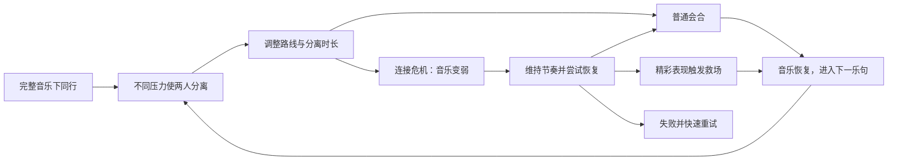

# 双人耳机线音游：原型设计梳理与评估

> 整理日期：2026-10-21
>
> 当前阶段：创意整理与原型设计
>
> 文档性质：对已有讨论的系统整理，供后续设计讨论和白盒验证使用
>
> 状态：讨论稿。核心体验已有明确描述，具体规则、产品形态和开发引擎尚未冻结；未实现白盒，未进行真人试玩。

## 目录

- [1. 设计概述与当前判断](#1-设计概述与当前判断)
- [2. 灵感来源与参考方向](#2-灵感来源与参考方向)
- [3. 体验目标与核心循环](#3-体验目标与核心循环)
- [4. 原型规则逐项梳理](#4-原型规则逐项梳理)
- [5. 双人协作如何成立](#5-双人协作如何成立)
- [6. 音乐衰减的价值与风险](#6-音乐衰减的价值与风险)
- [7. 救场与 Fever 的设计](#7-救场与-fever-的设计)
- [8. 最小白盒范围与验证顺序](#8-最小白盒范围与验证顺序)
- [9. 试玩与评估方法](#9-试玩与评估方法)
- [10. 产品形态与风格包装](#10-产品形态与风格包装)
- [11. 主要风险及应对方向](#11-主要风险及应对方向)
- [12. 决策状态与待定参数](#12-决策状态与待定参数)
- [13. 当前交付状态与下一步](#13-当前交付状态与下一步)
- [14. 参考与证据边界](#14-参考与证据边界)

## 1. 设计概述与当前判断

### 1.1 一句话定义

**一款双人合作节奏闯关游戏：两位主角通过耳机线共享一台 MP3 的音乐，在不断将彼此推远的压力下踩拍行动、维持连接，并在音乐即将消失时通过走位或精彩表现重新会合。**

音乐在设定中是角色的力量来源，在玩法中是双方行动的重要依据。耳机线将两个人的空间关系、听觉状态和共同处境联系起来。

### 1.2 核心价值

最值得验证的关系是：

> 我的走位会改变我们之间的距离；距离会改变我们共同听到的音乐；音乐又会影响我们继续行动和恢复局面的能力。

这种联系能让“照顾队友”变成具体行为。玩家可以调整自己的路线、等待时机、向队友靠近，或者在危急时凭稳定的节奏表现救回两个人。

耳机线同时具有两种潜在作用：

- **约束**：个人躲避不能完全忽略队友的位置和连接状态。
- **救援**：良好的判断或节奏表现可以帮助双方摆脱危机。

只有共同受罚，未必能产生有趣的合作。设计需要让玩家有机会主动改善对方的处境。

### 1.3 当前评估

这个构想具备清楚的视觉意象、体验循环和高潮目标，值得通过小白盒继续验证。

目前仍不能据此认定游戏已经好玩、具备商业可行性或拥有经过调查确认的独创性。最危险的两个假设是：

1. 距离约束能否让两个人产生有意义的协作，而不只是互相拖累。
2. 音乐衰减能否带来可挽回的紧张，而不只是让一次失误不断恶化。

8×8 棋盘适合用于检验这两个问题。它是当前的试验载体，最终产品不必因此固定为格子游戏。

## 2. 灵感来源与参考方向

### 2.1 共享有线耳机的场景

原始灵感来自两个人共享有线耳机、一起听音乐和移动的画面。

这个场景具有直观的行为含义：两人可以有不同的步伐和注意力，但有限的线长要求他们相互照顾。耳机线既是实物连接，也可以承载“同频、走散、重新靠近”的情绪。

本设计不依赖“耳机分线已经绝迹”这一未经调查的判断。即使玩家没有同样的生活经历，也应能通过画面和操作理解规则。

### 2.2 参考作品各自提供的方向

下表记录的是本设计希望借鉴的体验方向，不是对这些游戏全部机制的定义。

| 参考作品 | 希望借鉴的内容 | 对本设计的意义 |
|---|---|---|
| 《双人成行》 | 相互依赖、不同压力下的配合、共同完成一段体验 | 检查两人是否确实需要关注彼此，而非各玩各的 |
| 《Hi-Fi Rush》 | 动作、环境、对白与音乐节拍共同构成演出 | 参考重拍上的释放和音乐化表现，不直接照搬战斗系统 |
| 《Muse Dash》 | 鲜明色彩、角色辨识度、音乐带动的爽快反馈 | 作为美术与反馈风格候选 |
| 《节奏医生》 | 简洁输入与鲜明音乐体验的结合 | 控制基础操作数量，把变化集中在节奏与场景表达上 |

《Hi-Fi Rush》的开发者访谈特别强调操作响应性，并提到曾否决“没有踩准就不执行攻击”的方案。这个经验提示本原型应单独测试锁拍手感，但不能直接据此认定棋盘中的严格节拍移动不成立。[官方开发者访谈](https://news.xbox.com/en-us/2023/10/04/hi-fi-rush-exclusive-oral-history/)

## 3. 体验目标与核心循环

### 3.1 三个相互支撑的层面

| 层面 | 玩家处理的问题 | 希望产生的感受 |
|---|---|---|
| 节奏 | 什么时候行动，能否持续踩准 | “我进入状态了，我还能跟住。” |
| 空间 | 往哪里走，与队友保持什么距离 | “我得躲开这里，但不能把你甩下。” |
| 合作 | 谁调整路线，谁接应，谁来救场 | “这次你撑住了，下次我来。” |

三者需要互相影响。若移除队友后玩法几乎不变，合作可能还没有成立；若完全不用听音乐也能稳定完成全部挑战，听觉机制可能没有发挥预期作用。

### 3.2 建议的体验循环

这张图是体验关系图，不是已经确定的程序状态机。危机和特殊救场不必在每个循环中发生；稳定配合也应当是有效、值得追求的表现。

### 3.3 目标高潮

原始设想中的代表性画面是：

> 高难段落把两人逼得手忙脚乱，耳机线越拉越紧，音乐几乎听不见。一方仍然稳住节奏，打出一段 Perfect combo，把两人拉回彼此身边。完整音乐落回重拍，接一个短暂演出或对白，再进入 Fever。

这段体验可以拆成：

1. **建立节奏**：玩家先在完整音乐中形成稳定感。
2. **打破稳定**：压力迫使双方分开，声音开始丢失。
3. **主动挽回**：玩家凭判断和操作完成恢复。
4. **确认因果**：双方知道是谁、通过什么行为救回了局面。
5. **释放情绪**：音乐和操作反馈共同进入高潮。

“我永远不会离你太远”一类台词，应当出现在玩家已经用操作表达出这个意思之后。白盒即使没有台词，也需要能产生一次可感知的紧绷与释放。

## 4. 原型规则逐项梳理

本节区分原始设想与补充建议。所有具体数值都是待试验参数。

### 4.1 场地与角色

**原始设想：**两名各占一格的角色，在大约 8×8 的棋盘上移动。

**白盒建议：**

- 先采用同屏视角，保证两人和耳机线始终容易观察。
- 两名角色使用明确不同的颜色或标记。
- 只表现基础位置、危险预告、连接状态与必要的节拍反馈。
- 暂不加入复杂镜头切换、碰撞推挤和绳索绕障。

同屏是用于降低第一轮验证成本的建议，不等于已经确定最终只支持本地合作。

### 4.2 踩拍移动

**原始设想：**只有卡在节拍上的输入才能成功移动。

**待测试的基本形式：**

- 四向移动，一次有效输入移动一格。
- 每拍最多执行一步，允许玩家主动等待。
- 不允许通过连续乱按在同一拍累积多次移动。
- 错误输入给出可理解的反馈，例如过早、过晚或当前方向不可走。

需要分别评估两件事：

1. 玩家是否理解“什么时候能移动”。
2. 玩家是否觉得操作及时、可控。

“允许等待”不意味着等待总是安全。它提供一个可选动作，是否能使用由危险格和队友位置决定。

### 4.3 危险格

**原始设想：**每两拍，两个角色脚下出现危险格，玩家必须持续移动躲避。

需要补齐“出现”和“造成伤害”的时间关系。建议先采用：

> 锁定当前位置 → 明确预告若干拍 → 爆发 → 清除。

“每两拍锁定一次”和“预告两拍后爆发”是两个独立参数，不能混为一谈。预告两拍只是可以起测的一个例子。

同拍移动与伤害判定也需要统一约定，避免玩家在有效输入窗口内完成了合法移动，却因为结算顺序先被判死。

危险格命中即重开、扣共享耐久或短暂失误惩罚，均可作为测试方案。原始设想偏向击杀；共享耐久是讨论中提出的容错候选，尚未成为正式规则。

### 4.4 距离与耳机线

第一版可以只计算两个人的位置距离，用线的松紧、颜色或形态表达连接状态。

| 候选状态 | 表现 | 玩家需要理解的含义 |
|---|---|---|
| 舒适 | 音乐完整，连线放松 | 当前有足够的行动余地 |
| 拉紧 | 线绷紧，声音逐渐受影响 | 需要开始考虑会合或接应 |
| 危机 | 音乐明显变弱，恢复时间有限 | 需要主动挽回连接 |

两人格心的欧氏距离是可供白盒使用的简化方式。真实线长、MP3 的携带者、分线点和绕障路径，可以在后续需要时再细化。

将 MP3 放在连线中点作为视觉提示，也是白盒候选，不代表正式设定已经确定。

距离增加导致声音衰减是一种游戏化规则。最终可以通过连接受损、接触不良或更抽象的音乐力量设定解释，不需要把它当作真实耳机线材的物理模拟。

### 4.5 超距如何处理

| 方案 | 优点 | 主要风险 | 当前判断 |
|---|---|---|---|
| 硬性限制移动 | 规则直观，距离不会失控 | 可能挡住合法躲避，导致玩家被卡在危险格里 | 可比较，不优先定为默认 |
| 超距立即失败 | 清楚、简洁、容易建立紧迫感 | 没有恢复窗口，难以出现绝境救场 | 与目标高潮存在明显张力 |
| 允许短暂超距 | 能形成危机、恢复和救场 | 必须说明宽限时间与失败原因 | 当前较符合体验目标的候选 |

选择短暂超距并不等于要引入复杂资源系统。白盒可先用简单的拍数宽限表达恢复窗口，再判断是否需要耐久或其他机制。

### 4.6 失败与重试

失败需要回答“发生了什么”和“下次可以怎么做”。

建议至少区分：

- 踩拍失败，未能及时离开危险格。
- 路线选择导致持续超距。
- 会合路线或时机判断错误。
- 救场没有完成。

短关卡应能快速重试。调试时可以提供不中断运行的观察模式，用于分析恢复过程；观察模式中的表现不能直接算作正式通关结果。

## 5. 双人协作如何成立

### 5.1 当前规则的退化解

如果只有脚下追踪危险格，两名角色可能一直并排、同向移动，或者在少数格子间循环。

这样可以测试基础节拍输入，但耳机线未必参与决策。它是需要在白盒中主动检查的策略，不是已经通过试玩证实的问题。

### 5.2 最少需要一种差异压力

可选的设计手段包括：

- 两个人暂时拥有不同的安全方向。
- 一个人必须绕路，另一个人有空间向其靠近。
- 两处目标需要短暂分头处理，随后会合。

第一版只选择一种即可。目标是观察“为队友改变行动”是否自然发生，不是堆叠关卡机关。

一个示意情境：

> A 被扫线迫使绕到外侧。B 可以沿自己的最短路径继续逃，也可以向中间调整位置，给 A 留出连接距离。A 完成绕行后，两人会合。下一段交换双方承担的压力。

这只是关卡意图示例，尚未完成坐标、拍点和可解性设计。

### 5.3 必须保留共同可解路径

不能只保证“每个人单独都有地方躲”，还需要保证双方共同遵守连接规则时存在可行解。

关卡至少要检查：

- 分离是否可以被提前理解。
- 双方是否有足够的有效移动拍数。
- 会合路径是否被同时封死。
- 恢复窗口是否足以容纳必要动作。
- 一个合理失误后是否还有设计预期内的恢复机会。

手工短谱面更便于第一轮排查这些问题。随机生成可以后置，避免把不可解场景误认为高难度。

### 5.4 沟通与听拍共享注意力

以 120 BPM 为例，每拍 0.5 秒，两拍只有一秒。这个时间内，玩家可能需要同时看危险、选路线、说话、理解队友和踩拍。

因此，建议区分：

- **动作频率**：逐拍执行。
- **协作决策频率**：提前几拍理解共同路线。

可以尝试按四到八拍预告一段路线趋势，让双方形成共同预期。这个长度仍需测试。

交流的数量不是唯一成功标准。熟悉之后，玩家可能通过位置和动作直接理解彼此。需要观察的是互相照应是否存在，而不是要求全程不断说话。

## 6. 音乐衰减的价值与风险

### 6.1 为什么值得保留原案

“听不清后依然能跟住节奏”是原始高潮的重要组成部分。若一开始就规定始终保留清晰底鼓，可能提前削弱了需要验证的挑战。

因此应保留原案，与辅助版本做对照，再决定最终规则。

### 6.2 三种对照方案

三种方案使用相同谱面、移动判定和距离规则，只改变声音反馈。

| 方案 | 声音规则 | 主要验证问题 |
|---|---|---|
| A：完整音乐 | 距离影响连接状态，声音保持完整 | 距离约束本身是否产生合作和紧张 |
| B：整体渐弱 | 距离越远，音乐整体越难听清 | 玩家能否在声音损失中维持内在节奏并恢复 |
| C：保留微弱线索 | 旋律或配器逐渐丢失，留下微弱底鼓等线索 | 是否改善恢复能力，同时保留压力 |

耳机线上的视觉脉冲也可以作为辅助候选，但应另行控制强度。若同时改变声音和视觉提示，就难以判断究竟是哪一种变化影响了结果。

### 6.3 最主要的失败循环

> 距离增加 → 听不清 → 丢拍 → 无法移动 → 距离继续恶化。

评估重点是恢复路径是否仍可理解、可执行。

下列反馈具有不同含义：

| 玩家反馈 | 可能的解释 |
|---|---|
| “刚才慌了，但我知道怎么回来。” | 玩家仍理解规则，并感到有恢复空间 |
| “我听不到，也动不了，只能等失败。” | 声音惩罚可能移除了继续操作的必要依据 |
| “我一直看闪光，音乐变不变都无所谓。” | 辅助提示可能让听觉挑战失去作用 |
| “回来的那一下特别爽。” | 值得进一步确认是否源于操作因果和音乐恢复 |

### 6.4 音频与表现边界

- 音乐变弱时，节拍时间轴仍应连续运行；不能恢复声音时从头播放或跳到错误相位。
- 音频输出与输入延迟需要校准，否则设备问题可能被误认为规则问题。
- 同处一室、共用音箱的白盒，先按双方共享一个混音设计。
- 若未来希望两人分别听到不同内容，需要明确耳机、输出设备和联机方案，不能假设单一共享音箱能提供独立声音。
- 救场对白与音效不应遮住下一次关键节拍；可以安排在短暂安全的演出乐句中。

这些是后续实现与测试需要关注的条件，尚未在 Unity 或 UE5 中验证。

## 7. 救场与 Fever 的设计

### 7.1 保留单人发起的核心

原始设想强调一方在困难中稳住节奏，救回两个人。第一种救场试验应保留这一点。

“另一方必须在下一拍接应”可以作为后续对照方案，但不应提前成为默认要求，否则可能把原本的单人精彩表现改成双人 QTE。

### 7.2 候选操作流程

1. 连接进入危机，音乐明显衰减。
2. 一位玩家连续完成若干次高质量节拍动作。
3. 系统给出明确的救援可用提示。
4. 耳机线提示回拉方向和安全落点。
5. 在约定的重拍完成会合，恢复音乐。
6. 若条件满足，进入短暂 Fever 或其他释放段。

连续四次 Perfect、自动触发或额外按键触发，都只是待比较方案。

### 7.3 双方都需要理解因果

| 角色 | 理想感受 | 需要警惕的感受 |
|---|---|---|
| 施救者 | “这是我稳住节奏做到的。” | “系统随机给了一次保底。” |
| 被救者 | “我看懂了，而且这次确实被帮到了。” | “我正准备躲，却被强行拽走了。” |

回拉不能把队友送进未知危险格。落点可读性、当前输入如何处理、是否需要短暂保护，应在实际试验中一并检查。

### 7.4 Fever 首先承担释放作用

第一轮可以用非常简单的效果测试：

- 完整音乐恢复。
- 连线和角色出现明显变化。
- 当前危险短暂清除或暂停。
- 进入数拍的安全或强化段。

八拍是曾讨论过的候选长度，并未定案。

“Fever 乱杀”是最终体验想象，是否需要完整敌人、攻击、连招和战斗成长，应由后续玩法验证决定。白盒先确认音乐恢复和局面逆转本身是否有效。

### 7.5 防止故意制造危机

若救场的收益明显高于正常配合，玩家可能反复主动拉远，再刷取奖励。

可比较的方向包括：

- 救援次数有限。
- 正常合作表现积累 Fever，危机恢复不额外制造过高收益。
- 救场主要恢复局面，额外得分受到限制。

这些方案暂不需要同时实现。先记录是否出现主动利用，再针对实际问题调整。

## 8. 最小白盒范围与验证顺序

### 8.1 第一轮最小内容

| 项目 | 建议范围 |
|---|---|
| 玩家与场地 | 同屏两人，8×8，占位角色 |
| 输入 | 四向踩拍移动，明确成功与失败反馈 |
| 音乐 | 约 45～90 秒的固定节奏片段 |
| 危险 | 有清楚预告的脚下危险格 |
| 协作压力 | 一种手工设计的差异路线或扫线 |
| 连接 | 距离显示、状态提示和可调整的超距规则 |
| 音频 | 完整音乐、整体渐弱、保留微弱线索三种可比配置 |
| 重试 | 可理解的失败原因和快速重开 |
| 记录 | 输入误差、距离变化、失败原因和恢复耗时 |

该范围是验证提案，不代表已经完成开发排期或工作量估算。

### 8.2 逐层加入机制

| 阶段 | 内容 | 要回答的问题 |
|---|---|---|
| P0 | 节拍移动与危险格，音乐完整 | 基础操作是否清楚、顺手 |
| P1 | 加入差异压力与距离规则，音乐完整 | 两人是否真的开始照顾彼此 |
| P2 | 对比声音衰减方式 | 声音损失是否产生可恢复的紧张 |
| P3 | 加入一次有限的救场机会 | 是否产生可理解的共同释放 |

基础操作存在问题时，应先处理输入与反馈；距离规则没有产生协作时，应先检查关卡和共同目标。不要仅靠增加演出掩盖前一层的问题。

### 8.3 暂时后置的内容

- 完整动作战斗与敌人体系。
- 复杂绳索物理、绕障和绳索攻击。
- 在线联机及同步方案。
- 大量曲目、养成、装备和成长系统。
- 长剧情、完整角色关系和大量过场。
- 最终美术资产和正式内容生产工具。

后置表示当前证据不足以支持投入，不表示这些方向被永久排除。

## 9. 试玩与评估方法

### 9.1 需要证伪的假设

| 假设 | 试验方式 | 支持该假设的观察 | 挑战该假设的观察 |
|---|---|---|---|
| 连线增加真实协作 | 同一差异路线，对比开启与关闭距离规则，音乐均完整 | 玩家主动改变路线、接应或协调时机 | 始终同向循环即可通过，或只增加指责 |
| 声音衰减增加紧张与掌控 | 固定其他条件，对比 A、B、C 声音方案 | 玩家能说明如何在声音变弱时找回节奏 | 只延长失败过程，恢复方式不可理解 |
| 单人救场产生共同释放 | 同样危机片段，对比普通会合与节奏触发回拉 | 双方能说明救援因果，并认可这次恢复 | 被救者感到失去控制，或效果完全依赖演出 |
| 弱熟练度玩家仍有贡献 | 比较水平相近与差距较大的组合 | 不熟练者也能通过位置、路线或判断帮助队友 | 长期只能等待强者解决全部问题 |

### 9.2 试验安排

- 使用相同短谱面比较不同配置。
- 每次尽量只改变一类规则。
- 轮换试玩顺序，降低熟练效应对结论的影响。
- 至少包含节奏经验相近和明显不同的玩家组合。
- 记录具体行为和玩家解释，不只记录是否通关。
- 小样本用于发现问题，不能直接推导市场结论。

可以用调试入口直接进入危机，检验救场操作是否可执行。但这只能证明特定片段可测，还需要正常从头游玩，观察危机和高潮能否自然出现。

### 9.3 建议记录的数据

| 记录项 | 用途 |
|---|---|
| 每次输入相对节拍的偏差 | 区分操作熟练度、判定设置和延迟问题 |
| 两人距离随时间变化 | 判断分离来自关卡压力还是偶发操作 |
| 危机开始、结束和失败拍点 | 观察恢复窗口是否合理 |
| 失败原因 | 区分丢拍、路线错误、超距和不可解布局 |
| 救场触发及落点 | 检查因果、可读性和控制权问题 |
| 主动接应行为 | 判断合作是否超越共同惩罚 |
| 玩家对关键片段的描述 | 判断掌控感、归因和复玩意愿 |

### 9.4 试玩后的关键问题

1. 刚才哪一次行动是为了队友改变的？
2. 音乐变弱时，你觉得自己还能做什么？
3. 失败后，你知道下一次应怎样调整吗？
4. 救场由谁、通过什么动作完成？
5. 被拉回时，你觉得获得了帮助，还是失去了控制？
6. 你更想再试一次的原因是什么？

当前不设置未经数据支持的通关率或满意度门槛。先建立可重复观察的现象，再根据实际体验定义后续验收标准。

## 10. 产品形态与风格包装

### 10.1 当前优先方向

按歌曲组织的双人节奏闯关，能够把学习、变化、危机和释放放进同一段音乐结构中，适合作为当前产品方向候选。

最终空间形式应由白盒中实际出现的乐趣决定。

| 主要乐趣来源 | 更值得发展的方向 |
|---|---|
| 路线规划、距离管理、相互让位 | 俯视或格子式节奏闯关 |
| 临场跑位、追赶、回拉救援 | 连续空间中的节奏动作 |
| 歌曲变化、角色表达与重聚时刻 | 演出更集中的短曲叙事关卡 |

这些方向尚未完成成本比较，不意味着要同时开发。

### 10.2 夜间城市与共享混音带

一个与原始画面接近的包装候选是：

> 两个人共享一台 MP3 或一张混音带，穿过夜间城市。音乐响起，日常空间变成舞台；人流、车流、地铁门和城市噪声不断将他们分开，他们要踩着同一首歌重新靠近。

可建立的场景联系包括：

- 斑马线和地砖对应节拍格。
- 人流或车流对应方向明确的移动压力。
- 地铁门和绕行通道对应暂时分离。
- 安全区域和重聚位置对应一段音乐恢复。

这些只是表现与规则的映射候选，不构成已经确定的关卡清单。

### 10.3 人物关系与美术

两位主角可以是朋友、搭档或恋人。先通过操作形成互相照应，再选择最适合承载这种关系的角色设定。

美术可借鉴讨论中提出的明快色彩、鲜明角色和富有节奏感的反馈。第一优先级仍是：

- 看得清危险。
- 看得清队友和连接状态。
- 听得懂声音变化。
- 能区分普通行动、危机和恢复。

强烈特效和短过场应服务这些信息，而不遮住下一次操作。

## 11. 主要风险及应对方向

| 风险 | 具体表现 | 建议检查或应对 |
|---|---|---|
| 合作退化 | 两人始终并排或固定循环便能通过 | 加入少量差异路线，验证双方行动是否互相影响 |
| 失败不断恶化 | 听不清后无法行动，也无法恢复 | 对比原案与辅助版本，检查恢复窗口 |
| 锁拍挫败 | 玩家认为“按了却没反应” | 校准延迟，明确早晚反馈，测试判定窗口 |
| 无解关卡 | 各自能躲，但共同遵守距离时必败 | 检查联合路径与可用拍数，先用手工短谱面 |
| 交流干扰听拍 | 队友说话遮住音乐，来不及协调 | 提前展示路线意图，检查非语言信息是否足够 |
| 强弱差距过大 | 一方长期被动获救，另一方承担全部压力 | 观察位置与判断是否也能产生贡献，必要时调整任务分配 |
| 救场夺取控制 | 被拉回者正准备执行其他动作 | 提示方向、落点和时机，必要时比较接应机制 |
| 故意制造危机 | 玩家通过反复拉远刷高收益 | 区分正常配合收益与恢复收益 |
| 听觉机制被架空 | 玩家只看提示，音乐变化无关紧要 | 单独调整辅助强度，检查听觉挑战目标 |
| 高潮依赖演出 | 去掉台词和特效后没有恢复感 | 先用占位表现验证操作因果与声音恢复 |
| 产品范围膨胀 | 白盒尚未成立就加入战斗、养成和大量内容 | 按 P0～P3 逐层取得证据 |

上述风险来自规则推演，不是已经观察到的缺陷记录。

## 12. 决策状态与待定参数

### 12.1 当前应保留的设计目标

- 两位主角通过耳机线共享音乐。
- 节拍对行动有实质影响。
- 不同压力使两人产生分离。
- 距离变化影响共同处境与听觉体验。
- 玩家有主动挽回局面的机会。
- 保留一方精彩表现救回两人的高潮目标。

这些是原始构想的核心，不等于其具体实现已经冻结。

### 12.2 已讨论但尚未定案的项目

| 项目 | 讨论过的候选 | 当前状态 |
|---|---|---|
| 棋盘 | 8×8 | 原始白盒提议；最终产品未定 |
| 音乐长度 | 45～90 秒，约一分钟 | 白盒范围建议 |
| BPM | 120 BPM | 举例与起测候选 |
| 危险格频率 | 每两拍锁定一次 | 原始方向；预告与爆发细节待定 |
| 危险预告 | 例如两拍 | 建议参数 |
| 距离阈值 | 例如三格以内舒适、五格以外危机 | 初轮建议，尚未测量 |
| 超距处理 | 硬限制、立即失败、短暂宽限 | 倾向测试宽限，未定案 |
| 受击处理 | 击杀重开、共享耐久等 | 原案与容错候选待比较 |
| 音乐衰减 | 整体渐弱、削弱配器保留微弱线索 | 需保留对照，不预先替换原案 |
| 视觉辅助 | 耳机线脉冲等 | 可选，注意是否替代全部听觉信息 |
| 救场条件 | 例如连续四次 Perfect | 初轮建议，尚未验证 |
| 救场发起 | 自动或额外按键 | 未定 |
| 队友接应 | 无强制输入或增加接应动作 | 优先保留单人发起，接应作比较 |
| Fever | 例如八拍释放段 | 表现候选，完整战斗后置 |
| MP3 归属 | 连线中点提示或由角色携带 | 白盒与正式设定分别讨论 |
| 引擎 | 原始讨论提到 Unity 白盒，工作区以 UE5 开发为背景 | 本设计整理不作引擎选型 |
| 最终风格 | 明快音乐表现、夜间城市、共享混音带 | 候选包装 |
| 人物关系 | 朋友、搭档、恋人 | 未定 |

### 12.3 对早期建议的修订

以下内容不应被继续当作默认定案：

- 不要求先削弱原始声音惩罚，再进行测试。
- 不要求被救方一定参与双人 QTE。
- 不默认引入共享血条或完整耐久系统。
- 不把 120 BPM、三格／五格、四次 Perfect、八拍 Fever 当作经过验证的数值。
- 不因采用 8×8 白盒就冻结最终俯视棋盘形态。
- 不因城市画面贴近灵感就冻结世界观和人物关系。

这些修订的目的，是确保白盒仍在检验原始体验，同时保留合理的替代方案。

## 13. 当前交付状态与下一步

### 13.1 已完成的设计工作

- 整理原始设想与参考方向。
- 明确节奏、空间、合作三个体验层面。
- 梳理危险格、距离、声音、救场与 Fever 的关系。
- 区分核心目标、试验建议和未决参数。
- 提出最小白盒范围、对照实验与观察方法。
- 识别主要风险及其可检查表现。

### 13.2 未执行的验证

| 验证类别 | 状态 |
|---|---|
| 游戏代码与可操作白盒 | NOT RUN |
| 输入与音频延迟校准 | NOT RUN |
| 危险格与共同路径可解性实测 | NOT RUN |
| 双人真人试玩与合作体验 | NOT RUN |
| 音乐衰减的恢复能力 | NOT RUN |
| 救场、Fever 与过场体验 | NOT RUN |
| UE5 或 Unity 实现适配 | NOT RUN |
| 编译、Editor／PIE、自动化测试 | NOT RUN |
| 联机、性能、Cook／打包 | NOT RUN |
| 市场、竞品覆盖与原创性调查 | NOT RUN |

### 13.3 下一项最小产物

后续若进入白盒阶段，先把一段短谱面写成可执行的规则说明：

1. 明确基础输入与拍点判定。
2. 给出危险格锁定、预告、爆发、清除的顺序。
3. 设计一个可解的分离与会合片段。
4. 设置可切换的距离和声音配置。
5. 明确失败、重试和记录方式。
6. 基础循环成立后，再加入一次有限救场试验。

最关键的证据是：**两位真实玩家能否在音乐渐弱时，通过自己的判断和节奏表现重新靠近，并觉得这次恢复值得再来一遍。**

## 14. 参考与证据边界

### 14.1 设计来源

本文主要整理项目发起者提出的共享耳机、双人节拍行动、距离惩罚和极限救场构想，以及随后两轮设计讨论。

原始场景图片只作为视觉与关系母题参考，本文不依赖对图片人物、作品出处或耳机使用普及率的判断。

### 14.2 外部参考

- [Hi-Fi Rush：官方开发者口述历史](https://news.xbox.com/en-us/2023/10/04/hi-fi-rush-exclusive-oral-history/)：参考原型迭代、操作响应性与音乐化动作的取舍。其开发经验不能替代本原型的试玩。
- [Rhythm Doctor 官方网站](https://www.rhythmdr.com/)：参考简洁输入与音乐体验的方向。本文没有据此推导本项目的具体实现。

《双人成行》和《Muse Dash》在本文中作为发起者提出的体验、美术参考，不作为机制效果或市场表现的证据。

### 14.3 方法与结论的适用范围

本文是设计讨论的整理与评估，不是已经批准的完整开发规格、商业计划或通过验收的原型报告。
