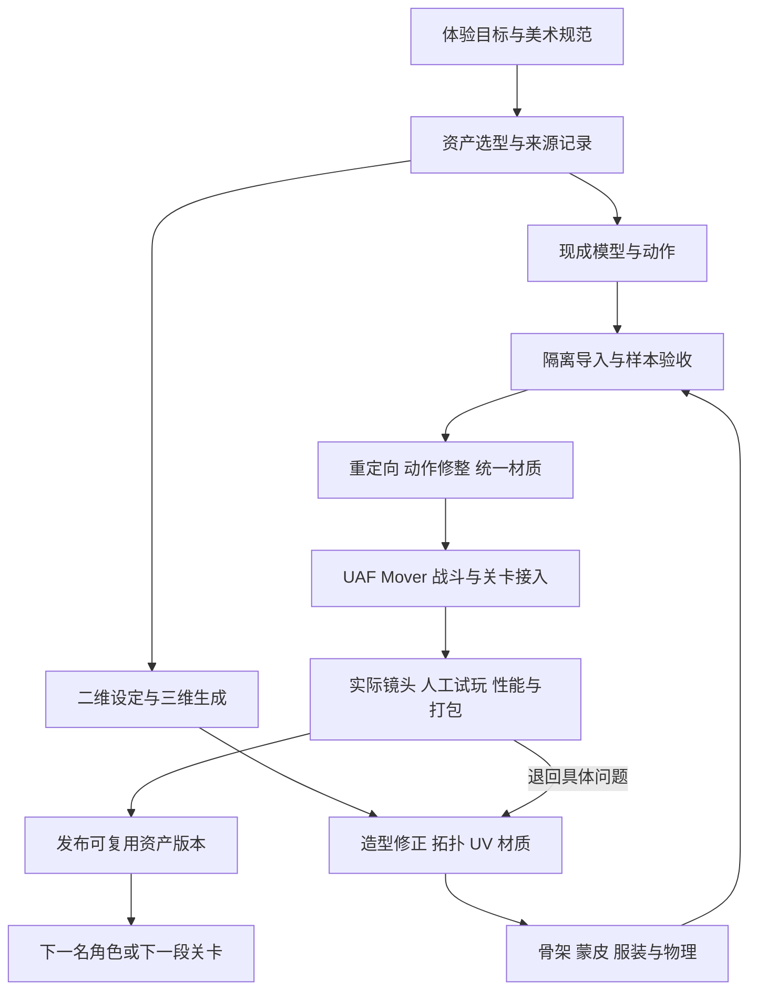

# 风林渡 ARPG Demo：游戏原型、技术方案与资产生产管线

日期：2026-10-25。阶段：概念与技术预研。工作名《风林渡》，剧情、规模和资产数量均为本方案建议，尚不是已经实现的游戏内容。

## 1. 需求与项目定位

制作一个 PC 单机、第三人称、画质优先的近战 ARPG Demo。参考《对马岛之魂》的近身刀剑战斗、自然景观、风动和电影化构图，形成一段可探索、可战斗、可失败重试、可通关的完整体验。帧率目标尚未确定；个人或很小团队制作，优先复用资产。

项目有两个同等重要的产物：**一段高完成度的游戏体验，以及一条能重复生产下一名角色、下一组动作和下一段关卡的工作流程。** AAA 品质在这里体现为风格一致、动作可信、交互清楚、镜头声音完整和稳定交付；内容体量按小团队控制。

| 已明确的需求 | 对方案的影响 |
|---|---|
| Nanite Foliage、World Partition、PCG | 采用有连续行进路线的森林山谷，让植被、生成和流送有实际用途 |
| 角色、动画与变形全部技术，尤其 UAF | 主角承担 UAF、Mover 与动作整合；近景角色提供面部和形变验证场景 |
| Unreal MCP | 用于编辑器生产、资产检查、批量操作与可重复验收 |
| PC 画质优先，帧率后定 | 先取得指定机器、分辨率和画质配置的性能基线，再确定预算；不默认 60 FPS |
| 个人或小团队，复用资产 | 先贯通一个角色和一套动作，避免同时维护多套体型、战斗系统和美术风格 |
| Fab 动作库、免费人物模型、可能由二维图生成三维 | 增加资产选型、加工、统一、绑定、动作修整和质量检查工序，不能以导入成功作为完成 |

尚待后续定下的制作参数是显卡/显存、目标输出分辨率、可投入时间、资产预算和主角风格。这些不阻碍本轮设计，但必须在扩大量产前确定。第三人称键鼠与手柄均列入输入设计；优先调哪一套操作，可在最小原型试玩时选择。

## 2. 游戏原型

### 2.1 玩家体验

玩家是一名穿行山谷的持刀旅人，需要夺回山口信物并打开渡口。开场在山脊看见远处风中的旧祠堂，沿林道接近废弃哨站，经过短小支路获得一种战斗强化，最终在开阔庭院与守关者决斗。

核心循环为：**观察地形与敌人 → 选择接近路线 → 试探、防御和反击 → 打破架势 → 获得补给或强化 → 开启捷径并继续前进。** 风向、道路轮廓和地标共同提供引导；战斗区域保留足够的地面与角色轮廓，植被不能淹没敌人的起手动作。

### 2.2 建议范围

| 项目 | 建议上限 | 制作理由 |
|---|---|---|
| 流程 | 首次体验约 15–25 分钟 | 容纳探索、学习、成长和最终决斗；实际时长由白盒试玩校准 |
| 地图 | 一个相连山谷，三段场景，一条主路和一个短支路 | 先按行进时间与视线设计，不提前用平方公里承诺内容量 |
| 玩家 | 1 名主角、1 种刀剑、1 套核心战斗动作 | 集中打磨手感、蒙皮和服装表现 |
| 敌人 | 2 种普通敌人行为 + 1 名精英，尽量共用一个人形动作标准 | 用节奏、装备轮廓与动作组合区分，而非新增多套骨架 |
| 战斗 | 3 处主要遭遇，最终一场单挑；普通遭遇同时参与近战者先限制为 2–3 名 | 控制 AI、镜头与动作资产的组合数量 |
| 移动 | 行走、跑动、短冲刺、闪避；一类低障碍翻越 | 需要真正可玩的运动衔接，暂不扩展骑马、攀岩、游泳 |
| ARPG 成长 | 一次二选一强化，例如提高架势伤害或改善防御后的恢复 | 形成战斗选择和成长反馈，避免背包、随机装备和技能树吞噬制作量 |
| 叙事 | 环境叙事 + 一段短近景交互 | 为 MetaHuman/角色表演提供用途，避免完整对话系统 |
| 交付 | 新游戏、检查点、死亡重试、结束界面、画质与输入设置、Windows 打包版 | 形成可独立体验的闭环 |

不纳入首个 Demo：开放世界任务网、多人联机、多个武器流派、大型城镇、全时段动态天气、复杂潜行生态和大量过场。这些不是当前六组重点技术成立的必要条件。

### 2.3 三段关卡与技术承载

| 场景 | 玩家行为与构图 | 主要技术与验收 |
|---|---|---|
| 山脊与风林入口 | 看见目的地，沿林道移动，跨越一个低障碍，接触第一次单敌战斗 | Nanite Foliage 近中远景；Motion Matching 启停；Mover 坡面与台阶；IK 足部接触 |
| 溪谷旧哨站 | 从两条路径接近小型遭遇，打开捷径，选择强化 | PCG 林缘和碎石；World Partition 边界往返；锁定侧移、受击取消、战斗资源预加载与存档 |
| 祠堂决斗庭院 | 与守关者交锋；结束后短近景交互或收刀镜头 | UAF 动作切换；受限 Motion Warping；Control Rig 手部与目光；MetaHuman 近景；局部 ML Deformer 对照 |

第三段近景的角色配置保持两种可替换方案：主角选用合适的 MetaHuman 基础时，复用主角完成；主角采用独立免费或生成角色时，用一名低内容量的 MetaHuman 交互角色完成。先选择一种，不同时养两条主角管线。

### 2.4 战斗的最小规则

轻攻击三段、重攻击一段、格挡、时机防御、闪避、受击、破防和倒地构成第一套规则。生命、架势和有限恢复道具足够支持体验；先用攻击恢复窗口约束连打，耐力系统是否增加由试玩决定。

每个攻击明确前摇、命中窗口、后摇、可取消窗口和目标转向限制。战斗动作由明确的动作定义选择；Motion Matching 首先服务移动与过渡。不能让姿态检索任意改变玩家需要学习的攻击节奏。

命中使用武器轨迹与碰撞检测，动作窗口内按目标去重；伤害、音效、镜头震动和特效由同一次命中事件派发。顿帧、慢动作和受击打断需要明确动作时钟与移动时钟的关系，防止动画暂停后角色继续前冲。

## 3. 技术采用清单

“集成到主线”表示进入最终可玩目标；“局部集成”表示在特定角色或镜头中实际运行；“试验”表示尚需证实的组合。仅启用插件、播放外部示例或展示静态截图，都不能算本 Demo 已完成该技术。

| 技术 | 放在哪里、解决什么 | 验收产物 | 主要条件 |
|---|---|---|---|
| Nanite Foliage | 主线路旁及远景的 1–2 种代表性树木 | 可近看、穿行、转身观察风动的森林片段；传统方案对照采样 | 新管线资产与风系统，不能将普通 Nanite 树直接等同新功能 |
| World Partition | 三段相连路线与往返流送 | 冷启动、跨区、返回、死亡重载录像及加载记录 | 检查跨区引用、加载时机与返回区域后的玩法状态 |
| PCG | 按地形、路径、生态区规则布置林木、碎石和地被 | 同种子可重建；改道后正确留空；可人工覆盖 | 玩法布局由人设计，装饰生成规则化 |
| Motion Matching / Pose Search | 主角移动、启停和转向 | 轨迹、候选姿态与最终选择可观察，具有完整移动动作覆盖 | 动作数据库的风格、速度、脚接触需一致 |
| IK Rig / IK Retargeter | Fab 动作到目标人物的动作转换 | 一套动作在主角和一个不同体型上验证手脚接触 | 源和目标的链、姿态、比例及 Root/Pelvis 处理 |
| Motion Warping / Pose Warping | 翻越对齐、有限攻击步进；方向、步幅与坡面姿态适配 | 不同距离角度的接触对照，越界时拒绝或换动作 | Warping 不能代替碰撞、导航和动作覆盖 |
| Control Rig | 离线修动作；运行时脚、手、目光的最后修正 | 双手握持、坡面与转头连续性 | 每根骨骼的修正顺序与权重明确 |
| UAF | 主角的移动、动作层与姿态组合 | 主角实际由 UAF 参与最终姿态生成，能追踪输入、层切换和输出 | Experimental；用最小组合先验证，不以 AnimBP 对照冒充完成 |
| ML Deformer | 一个可见关节的近景形变修正 | 自有目标网格训练结果、未训练姿势 A/B、成本记录 | 同拓扑参考形变数据是前置产物；无数据时记为未完成 |
| MetaHuman | 一个近景角色或主角基础 | 面部、身体衔接与 LOD 实际镜头 | 角色选型、服装兼容与头发成本；不假设可直接接入全部 UAF 路径 |
| Mover | 主角真实碰撞移动、模式切换与动作位移 | 坡面、台阶、翻越、受击取消、低帧率行为记录 | Experimental；验证移动、碰撞与动作位移的组合 |
| Unreal MCP | 编辑器制作、查询、批量布置和检查 | 一条可重复、有差异清单、有运行复核的制作任务 | 本会话尚未连接 UE MCP；必须先验证实际 Toolset 能力 |

配套渲染使用 Lumen、VSM、TSR 和一致的曝光/色彩管理；这些为画面服务，不额外扩展成独立研究项目。材质先以可维护的 PBR 母材质和实例形成稳定基线，是否引入更多实验材质能力由具体效果需要决定。

## 4. UAF、Mover 与战斗架构

### 4.1 先验证哪些组合

首版围绕玩家实际体验划分验证场景。下面列的是项目需要达到的结果，具体接口与执行方式在最小实验场中确定。

| 组合 | 需要证明的结果 | 最小测试 |
|---|---|---|
| 输入、Mover 与移动动画 | 按键方向、角色碰撞移动和画面中的步态一致 | 平地启停、转向、坡面、台阶和锁定侧移 |
| 攻击、位移与碰撞 | 斩击的前进距离和武器接触符合动作，障碍前不会穿墙 | 原地攻击、带位移攻击和贴墙攻击 |
| 受击与重新行动 | 玩家能看清受击反馈，并按设计恢复移动或防御 | 攻击中受击、死亡重试和再次交战 |
| 动画与表现 | 武器接触、声音、火花和镜头反馈出现在正确时刻 | 同镜头逐帧检查命中、格挡和破防 |
| 遭遇与检查点 | 离开、返回和死亡重试后的敌人、奖励与机关状态符合关卡规则 | 一次遭遇、一次奖励和一个检查点的完整往返 |

首版先用小规模玩法实现与数据资产支撑这些测试，蓝图负责关卡组合和表现配置；不预先扩展到大量技能、装备或联网系统。

### 4.2 UAF 的实际学习与落地范围

官方 UAF 插件索引标记 Experimental，并列出 Pose Search、Control Rig、Warping 和 Mover UAF 等相关插件。公开列出的关联只提供研究入口，不能替代当前角色的组合实测。[UAF 官方插件索引](https://dev.epicgames.com/documentation/en-us/unreal-engine/API/PluginIndex/UAF)

按五个可观察层次推进：

1. **数据输入**：先列出移动与动作所需的速度、方向、地面状态、预测轨迹、动作阶段、锁定目标和角色质量档；逐项验证输入变化能否在角色表现中正确反映。
2. **姿态来源**：移动用 Pose Search 检索；攻击、闪避和受击用明确动作集合；暂不做“任意动作全自动检索”。
3. **组合顺序**：移动/全身动作选择 → 合适的混合与惯性过渡 → 有边界的姿态扭曲 → 手脚与目光修正。全身动作生效时，应停用与它冲突的移动修正。
4. **模块与执行**：在目标版本中验证 UAF 资产、模块数据、执行事件，以及与 Mover 的组合；先用公开文档和样例支持的功能建立小样，再评估适配工作。
5. **调试和维护**：能在同一录像中观察当前动作、移动模式、Pose Search 结果、根运动和最终姿态；分别记录更新与求值成本。更换角色、动作和质量档后复验。

身体、面部与脖颈衔接需要单独验证。分步接入 UAF、Control Rig 与 MetaHuman 表现，每增加一项就检查动作连续性、手脚接触和头身衔接，避免多项改动叠在一起后无法判断画面问题来自哪里。

### 4.3 Mover 与根运动：首个必须解决的技术试验

Mover 官方文档将 Movement Mode 与临时叠加的 Layered Move 分开介绍，后者可用于动画根运动；也提供面向非联网游戏的 Standalone 后端说明。单机 Demo 优先评估这条路径。Mover 本身仍为 Experimental。[Mover 官方概念说明](https://dev.epicgames.com/documentation/en-us/unreal-engine/mover-features-and-concepts-in-unreal-engine)

Motion Warping 的公开流程围绕根运动、修正窗口与目标展开；不能据此断言选定 UAF 角色已经接通全部功能。**纯 UAF 动作、根运动与 Motion Warping 全链路接通，仍是待验证项。** 测试需覆盖动画位移与移动结果的时间关系、不同帧率和碰撞条件。[Motion Warping 文档](https://dev.epicgames.com/documentation/en-us/unreal-engine/motion-warping-in-unreal-engine)

首个试验只做“移动 → 一次带位移斩击 → 受击取消 → 恢复移动”：

- 先跑无根运动的 UAF 移动与 Mover 碰撞，再接入一个已知位移的根运动片段。
- 分别验证 UAF 属性输出、根运动读取、Mover 应用与最终 Mesh 显示的时间关系；动画产生量不能在一帧被消费两次。
- 最后增加一个 Warping 目标和翻越动作，记录目标位置、未修正根运动、修正结果、碰撞后结果。
- 用 30/60/120 FPS 限制与人为帧尖峰测试一致性。这些是测试条件，不是产品帧率目标。
- 检查受击、死亡、重新载入和再次开始后，角色是否停止原有攻击位移，并能按规则重新操作。

若属性路径暂时不满足需求，先验证官方已有动作/根运动适配路径，或增加一层有明确时序的适配；对照角色可保留成熟 AnimBP 方案用于定位差异。**UAF 主角目标仍保留**，降级必须记录覆盖缺口。若基础组合持续失败，缩减首段内容并保留试验结论，不在不稳定控制器上继续堆美术。

### 4.4 敌人行为与战斗节奏

AI 首版计划用行为树组织巡逻、发现、靠近、占位、攻击、受击和死亡。普通遭遇先限制同时发起近战的敌人数量，并拉开攻击节奏，使玩家能读懂敌人行动。两种敌人的差异先来自节奏和招式组合，不引入训练式 AI。行为树的功能入口参见 [官方概览](https://dev.epicgames.com/documentation/unreal-engine/behavior-tree-in-unreal-engine---overview)。

验证重点是敌人起手是否可读、距离是否合适、障碍是否影响靠近，以及玩家失败后能否正常重新开始同一场遭遇。具体 AI 节点与任务实现留到白盒阶段确定。

## 5. 森林、World Partition 与 PCG

### 5.1 先画可玩的关卡，再生成环境

关卡首先以角色速度、相机视野、战斗距离和退路做白盒。固定道路、遭遇区、翻越点、眺望点、地标与检查点；这些是 PCG 的输入和排除区。PCG 再按坡度、高度、道路距离、生态分区和随机种子布置植被与碎石。

保留四层数据：人工玩法布局、生成规则与种子、生成输出、人工修饰。重生成不能覆盖关键交互物和人工修改；修改来源应能反查。首版优先编辑器内生成与 Cook，只有明确出现运行时变化需求时，再引入运行时生成。

### 5.2 新 Nanite Foliage 的资产工序

官方新 Nanite Foliage 由 Assemblies、Voxels、Skinning 等系统构成，仍为 Experimental。其风动与传统叶片卡片加 WPO 的工作方式不同；Fab 商品写着“Nanite”不足以证明符合这条新管线。[Nanite Foliage 文档](https://dev.epicgames.com/documentation/en-us/unreal-engine/nanite-foliage)

先选一种树，确认几何叶片/枝条、可复用部件、组装、骨骼风动、材质与距离表现的完整链路，再扩展到第二种。可评估官方 Procedural Vegetation Editor，但它也是实验性入口，不能假定任意植物包能一键转换。[PVE 官方说明](https://dev.epicgames.com/documentation/unreal-engine/procedural-vegetation-editor-pve-in-unreal-engine)

在同一风向参数下协调树木、地被、布条、落叶粒子与环境声音；新旧植被系统需要各自适配这一参数。测试近景透光、树冠轮廓、远景稳定性、阴影、显存、快速转镜与风动成本。不要默认全部植被都需要碰撞，也不要默认新蒙皮植被可沿用任意 HLOD 构建策略。

### 5.3 流送与持久状态

World Partition 管理空间加载。关卡还需要明确返回区域时的玩法规则：敌人是否重生、奖励是否已经领取、机关是否保持开启，以及死亡重试恢复到哪个检查点。把这些结果列入往返与存档测试，具体存储实现留到工程阶段确定。

开始采用单一清楚的流送配置，依据实际路线与速度调 Cell/Loading Range。官方文档说明 Actor 间引用可能使对象捆绑加载；因此要检查跨区硬引用，而非只看分区格子是否漂亮。[World Partition 文档](https://dev.epicgames.com/documentation/en-us/unreal-engine/world-partition-in-unreal-engine)

PCG 的 Data Layer、HLOD 归属需要显式设计和核验；它们能与 World Partition 协作，但不会自动完成存档、碰撞和玩法状态管理。[PCG 与 World Partition](https://dev.epicgames.com/documentation/en-us/unreal-engine/using-pcg-with-world-partition-in-unreal-engine)

大型远景建筑和岩体评估 HLOD；角色、交互物、植被分别制定加载与表示策略。检查点重生先完成所需区域和动作资源加载，再交还控制。沿固定路线测试冷启动、快速前进、掉头返回、死亡重生和打包后的表现。

## 6. 需要补齐的生产管线

Fab、免费模型和图生三维解决的是资产来源。要让它们组成质量一致的游戏，还需要下列工序。**最常被低估的是选型之后的适配成本：骨架能重定向，并不意味着拔刀、握柄、转身和翻越都可信。**



### 6.1 全流程的输入、产物与完成依据

| 工序 | 输入与工作 | 必须留下的产物 | 通过条件 |
|---|---|---|---|
| 美术定向 | 游戏体验、参考图、角色身份与地域气质 | 简短 Art Bible：色板、比例、轮廓、材质样板、光照和禁用示例 | 不同来源资产放进同一测试镜头能判断是否合适 |
| 资产选型 | Fab 包、免费模型、生成服务候选 | 候选清单、来源/许可记录、兼容性和适配成本 | 一份小样通过后才批量采购或导入 |
| 隔离接入 | 原始下载包和可编辑源文件 | 保留原包的导入项目/目录、版本号、导入设置 | 不污染主工程；依赖、比例、骨架和材质可核对 |
| 模型加工 | 网格、扫描或生成结果 | 清理后的游戏网格、需要时保留高模、拆件与命名 | 轮廓符合设定，无严重破面/重复层/不可用关节 |
| UV 与贴图 | 目标网格及表面参考 | UV、烘焙、PBR 贴图、源工程、纹理配置 | 接缝、法线、色彩空间、粗糙度与密度符合场景 |
| 绑定与蒙皮 | 目标体型、标准骨架与服装 | 骨架映射、蒙皮、扭转/辅助骨、Socket、Physics Asset | 深蹲、抬臂、握剑、扭腰和翻越无明显塌陷穿插 |
| 动作适配 | Fab 动作、目标 Rig、动作需求表 | 重定向结果、修整动作、Root Motion 规则和动作元数据 | 接触、位移和时序准确，动作间能连续切换 |
| 引擎整合 | 合格角色与动作 | UAF 图、数据库、动作定义、材质实例、碰撞和效果配置 | 真实输入驱动，受击/取消/死亡/重试闭环成立 |
| 关卡生产 | 白盒、模块套件、合格植被 | 路线、PCG 规则、排除区、人工布景、流送配置 | 可导航、可战斗、可重生成、可往返 |
| 表现整合 | 已成立的动作与镜头 | 音效、粒子、UI、相机和短表演 | 命中、危险、任务反馈清楚，风格与节奏一致 |
| 性能与交付 | 固定测试路线和打包版本 | 分辨率/画质/机器记录、性能采样、问题列表、版本清单 | 达到本阶段约定质量，并能从冷启动完整通关 |
| 发布到内部资产库 | 通过检查的资产与依赖 | 可复用版本、预览、使用说明、限制和回退版本 | 换到新测试关卡仍能工作，下一次不重新猜导入参数 |

这些工序可以由同一个人承担，但不能因为团队小就消失。每道工序都有明确退回位置：握剑不对退回动作/手部修正，关节塌陷退回蒙皮，远景闪烁退回材质/植被表示，跨区卡顿退回加载与资源预算。

### 6.2 美术规范与资产统一

建议先做一页角色轮廓、一页环境色板、一页材质样板和三张目标镜头。主角用清楚的上身/武器轮廓和一处识别色；环境按冷绿林荫、暖色道路、低饱和岩石组织层次。风格可由你调整，但先用少量规则约束资产选择。

《对马岛之魂》的官方美术分享强调主题、轮廓、环境色彩和世界视觉统一。这里借鉴这种美术组织方法，具体角色与地点另行设计。[Sucker Punch 美术流程分享](https://blog.playstation.com/2020/10/26/from-brush-to-blade-the-concept-art-process-behind-ghost-of-tsushima/)

资产统一至少覆盖：实际尺寸、身体比例、表面细节尺度、磨损程度、颜色饱和度、金属与粗糙度、法线强度、阴影/透光、风动强度和摄影曝光。不能仅套一个 LUT 期待所有来源自动统一。

测试场景分为中性光照材质室和实际游戏林间镜头。前者发现资产自身问题，后者判断角色在逆光、树影和运动中能否看清。角色验收必须用计划中的游戏摄像机距离；近景和宣传截图另外验收。

### 6.3 资产选型与 Fab 动作采购

先建立“需要哪些动作”，再选包。候选动作优先按风格一致和缺口大小筛选，而非数量最多。优先同一作者或同一风格的主动作库，其他库只补少量缺口。

| 类别 | 首批必须覆盖 | 购买或下载前重点检查 |
|---|---|---|
| 自由移动 | 待机、走跑、启停、左右转向、必要的转身 | 实际速度、方向覆盖、根骨、脚接触与动作持续段 |
| 战斗移动 | 持剑待机、进退、侧移、锁定转向 | 持械姿势是否与攻击相符，侧向步法是否足够 |
| 进攻 | 三段轻击、一种重击、破防后反击 | 武器类型、左右手、位移、转身、起止姿势及衔接 |
| 防御与受击 | 格挡、时机防御反馈、闪避、方向受击、破防、死亡 | 是完整动作还是仅展示片段；是否需要额外起身动作 |
| 场景动作 | 一类翻越、交互、收拔刀 | 高度/距离范围、手部接触、道具和身体比例 |
| 双人动作 | 若采用处决或配对交互，必须成对取得 | 两个角色的相对坐标、时间同步、体型和地形限制 |

采购检查表包括：UE 版本、资产格式、源骨架、Root Motion 与 In-place 是否齐全、可编辑源文件、动作列表、预览视频、重定向说明、依赖插件和许可。尤其检查 Root 与 Pelvis 的职责：角色看起来向前跑，不代表片段含有可消费的根位移。

先验收一组代表性动作：急停转向、攻击、闪避、深蹲/翻越，再决定整包是否适用。记录“入库到可用花了多少人工时间”。免费但需要大量重做的角色，可能比一份可用小资产更昂贵。

来源台账至少记录资产 ID、作者、原 URL、下载日期、版本、许可文本/链接、署名要求、允许用途核对结果、原包位置、衍生文件和使用场景。Fab 存在不同许可类型，不能将“免费”视为统一使用条件；具体资产按实际条款核对。[Fab 许可分类](https://dev.epicgames.com/documentation/fab/licenses-and-pricing-in-fab?lang=en-US)

### 6.4 角色路线 A：现成免费角色优先

第一名可玩角色优先选有可用骨架、较干净权重、服装分件和 PBR 材质的模型。造型可以先不完全等于最终设定，但身体比例与服装轮廓应接近最终目标，否则后期替换会使握剑、翻越和镜头重新返工。

确定一个项目标准人形体型和动作规范。不同来源骨架可通过 IK Rig/Retargeter 转换，不要求直接把全部原始骨架改成同名；重点是明确目标链、重定向姿态、根位移和接触目标。[IK Rig 重定向文档](https://dev.epicgames.com/documentation/en-us/unreal-engine/ik-rig-animation-retargeting-in-unreal-engine)

对小团队，优先评估“复用身体与成熟 Rig，修改服装、配饰、头部和材质”的路线。减少长袍、复杂飘带和大型发型的首版数量；布料外形需要参与战斗轮廓设计，动态模拟在基本动作通过后再加。

### 6.5 角色路线 B：你提供二维图，生成三维

这条路线可以成为资产来源，但二维图片通常没有定义背面、遮挡结构、真实尺寸、服装层次和可变形关节。需要先把这些补成一致设定，再进入生成与加工。当前会话没有已验证可调用的图生三维服务，不能承诺现在直接交付可战斗的绑定角色；生成服务的接入、导出格式和实际质量是这条路线的前置验证。

| 步骤 | 需要完成的工作 | 产物与验收 |
|---|---|---|
| 设定补全 | 确定身高比例、正侧背面、脸手特写、服装层次、材质和武器尺寸 | 一致的角色设定包；不同视图不能出现不同衣服或身体比例 |
| 生成输入整理 | 中性姿态、完整轮廓、尽量无遮挡；明确对称性与需要拆开的部件 | 可复现的输入图与参数，避免将强光影烘进外观 |
| 三维生成小样 | 用选定服务试一个低成本样本，检查导出网格和贴图 | 先确认造型相似度、背面、手、面部和衣物结构 |
| 造型与结构修复 | 在 DCC 中修正比例、粘连、洞、重复壳、手指、衣层和硬表面部件 | 可编辑模型；武器、身体、衣服按需要分离 |
| 重拓扑 | 让关节附近几何支持实际变形；必要时由高模重建游戏网格 | 肩肘膝、髋、嘴眼等区域在动作中不崩坏 |
| UV、烘焙与 PBR | 重排 UV，传递高模细节，去除不应固定在颜色中的光影，补粗糙度/金属等 | 中性光照下可信的材质，保存贴图源文件 |
| 绑定与动作适配 | 适配目标骨架、蒙皮修正、扭转骨、手指、Socket；完成一组目标动作 | 进入与路线 A 相同的角色测试场验收 |
| 细节与成本处理 | 头发、布料、碰撞、LOD、材质数量、纹理驻留与阴影 | 游戏镜头与性能通过后才替换正式主角 |

Meshy 等服务可以列为图生三维候选。其官方说明也将姿态、参考视图、脸手问题和后续 DCC 修正作为实际工作环节；这证明需要设计加工流程，并不构成对某服务输出质量的保证。[Meshy 输入与模型修正说明](https://help.meshy.ai/en/articles/16102152-fix-character-pose-face-and-hand-issues-in-meshy)

重拓扑不是简单“减面”。变形网格需要适合关节运动的结构；刚性道具则依据轮廓、表面和引擎表示选择加工方式，不要求全项目网格统一做成四边面。[Blender 重拓扑说明](https://docs.blender.org/manual/en/5.4/modeling/meshes/retopology.html)

推荐学习次序为：先生成石像、面具或其他刚性道具 → 再做可绑定配饰/衣装 → 最后尝试完整主角。完整生成角色仍是可选的最终造型路线，前面的可玩 Demo 能提供明确的验收标准。

### 6.6 模型、材质与物理的交接规范

每份交接写清单位、朝向、缩放、坐标原点、导入方式、骨架版本和源文件。UE 内以厘米校验实际尺寸；不同 DCC 轴向通过验证过的导出预设转换，避免反复手动旋转补偿。

角色材质按皮肤、布料、金属、皮革、头发划分，环境按岩石、木材、土壤和植被划分。共享母材质与参数约定，允许特殊皮肤/头发保留专用着色；不把所有资产强行套成同一张万能材质。Base Color 与数据贴图采用正确色彩空间，法线约定和通道打包必须记录。

贴图分辨率、材质槽、几何量和骨骼数量先设试用预算，再以实际镜头与显存数据修订。不要每个资产都默认 4K/8K。近景主角、普通敌人、远景角色分别评估；Nanite 不免除角色蒙皮、材质、透明头发、阴影和纹理成本。

碰撞采用有明确用途的表示：移动碰撞、武器命中、布料碰撞和倒地物理分别检查。服装先验证极限姿势，再加布料；裙摆/披风碰撞、身体穿透、转身拖尾和重置后的稳定性均需要验收。首版头发选择依据游戏镜头与预算，Groom 的使用不是角色高质量的必要条件。

## 7. 动画、面部与形变生产

### 7.1 动作入库流程

原始动画 → 确认骨架/单位/帧率/根运动 → IK 重定向 → 修正手脚接触和服装穿插 → 标注动作元数据 → 加入移动数据库或动作定义 → UAF/Mover 接入 → 战斗镜头验收。

对每段动作保存来源、目标骨架版本、持续时间、位移与旋转、起止姿态、左右脚接触区间、武器 Socket、动作窗口、可取消段、Warping 窗口、允许目标范围和修整记录。在实际战斗镜头中逐项核对这些标记与可见动作是否一致，修改动画后重新检查。

重定向后至少检查脚滑、脚穿地、膝盖朝向、髋高度、肩膀挤压、手腕扭转、剑柄接触和收拔刀位置。通过 Control Rig 或 DCC 修整结果保存为可版本化资产；不把每个资产缺陷都交给昂贵的运行时 IK 掩盖。

Motion Matching 数据库按移动状态和可检索范围组织，检查运动轨迹、速度尺度、采样骨骼、脚接触和选择抖动。没有侧移、急停或转身覆盖时，先补素材；调检索权重无法创造不存在的动作。

### 7.2 复用 Game Animation Sample 的边界

本轮核实官方已发布 **UE 5.8 版 Game Animation Sample**，可作为移动、Mover、姿态检索和交互的参考。旧研究中的 5.7 入口不再是唯一候选。5.8 更新包含多角色交互检索与物理角色示例，但该文章并未证明“完整工程已经全面采用 UAF”。[官方 5.8 更新](https://www.unrealengine.com/tech-blog/download-the-latest-game-animation-sample-project-now-updated-for-ue-5-8)

采用方式是先建立独立样例工程观察，再迁入需要的资产和机制到实验场。不要同时带入所有测试地图、角色类型、布娃娃交互和演示 UI。样例移动效果也不等于刀剑战斗已经成立；Fab 的持械移动与样例无武器移动风格必须统一。

### 7.3 MetaHuman 的落地范围

目标是一个真正进入游戏的近景角色：有短暂表情变化、目光、身体动作与面部的衔接，并能切换 LOD。主角与配角二选一路线见 2.3；不为展示技术引入一整个人群系统。

官方有 MetaHuman 接入 Game Animation Sample 的路径，其中涉及角色组件和重定向 AnimBP。它可用来理解身体/面部/LOD 关系，但不能直接当作本项目 UAF 角色的完成方案。[官方角色接入说明](https://dev.epicgames.com/documentation/en-us/unreal-engine/adding-a-metahuman-to-the-game-animation-sample-project-in-unreal-engine)

面部制作先用短时长、有限表情的可控表演；是否采用面捕或其他捕捉流程，由角色镜头需要决定。明确面部源、修整资产、身体动作、目光、相机、声音和跳过/中断后的恢复，避免只做出一段离线视频。

### 7.4 ML Deformer 要额外补的整条数据链

ML Deformer 学习角色形变修正，不能替代角色建模、绑定或动作生成。官方流程依赖目标 Skeletal Mesh、相应姿势的 Animation Sequence 和作为参考形变的 Geometry Cache。训练输入与目标必须匹配。[ML Deformer 文档](https://dev.epicgames.com/documentation/en-us/unreal-engine/ml-deformer-framework-in-unreal-engine)

本项目只选择一处可见且有价值的变形问题，例如肩部抬臂或肘部弯曲。制作流程为：

1. 固定目标网格拓扑、骨架、基础蒙皮和导入版本。
2. 准备训练动作覆盖目标关节范围，用高质量修形、绑定或模拟生成对应参考形变。
3. 导出与动画时间对应的 Geometry Cache，核对顶点对应、时间采样与坐标。
4. 训练模型，另留未参与训练的攻击、格挡和翻越姿势作为验证集。
5. 用同镜头、同光照比较基础蒙皮、常规修形与 ML 结果，并记录成本。
6. 完成角色运行时接入与质量档切换；发生异常时回退基础蒙皮或常规修形。

资产交付必须包括网格/骨架版本、训练姿势、参考形变、训练配置、模型、验证动作与结果。换了角色拓扑不能假定旧模型还能继续用。

若现阶段没有可生成合格参考形变的能力，先在兼容示例中学习，再补本项目数据；技术覆盖表中继续标为未完成。盔甲完全遮住的区域也不适合拿来声称“游戏中有明显提升”。这项工作的主要成本在数据生产，不能只排一个“开启插件”的任务。

## 8. 关卡与整体现实感的生产流程

### 8.1 关卡从白盒到成品

任务节奏图 → 白盒路线 → 相机与战斗空间测试 → 模块套件与材质样板 → 一段完整环境样板 → PCG 规则与人工布景 → 流送/导航/碰撞 → 灯光、声音和特效 → 打包复验。

白盒先验证三件事：玩家能否找到路、战斗能否移动退避、镜头能否保持敌人可见。树、石头、建筑和高草加入后重复验证，不能把白盒阶段的通过沿用到最终环境。

模块资产需要统一尺度与拼接规则。桥、台阶、墙、屋顶与地面接缝分别做样本；用 Decal、顶点混合与少量独特道具增加变化。PCG 密度不作为美术质量指标：关键轮廓、视觉留白和有意设置的视线更重要。

### 8.2 材质与灯光

先建立固定曝光与日照条件下的材料样板，再确定林荫、逆光和祠堂近景的表现。对“写实”做可检查的定义：物体尺寸合理、表面粗糙度有区分、接触阴影可信、角色与背景有层次，而非单纯提升纹理分辨率。

首个 Demo 用少量经过设计的光照状态；完整昼夜系统会扩大所有材质与关卡的验收组合。镜头中要分别检查静态截图和快速运动，尤其树叶、头发、剑刃、粒子与薄布的时域残影。

### 8.3 声音、特效、镜头与 UI

完整管线还必须包含这些经常被遗漏的工序：

| 领域 | 本切片最小交付 | 关键检查 |
|---|---|---|
| 音频 | 地表脚步、挥刀/命中/格挡、受击、风林环境、界面反馈、音乐段落 | 材质与事件对应、响度层级、远近与遮挡、循环接缝、来源记录 |
| VFX | 命中、格挡火花、破防反馈、少量落叶/风尘 | 不遮蔽敌人起手，事件不重复，透明开销可测 |
| 相机 | 自由探索、锁定、狭窄空间、受击、短近景交互 | 墙体碰撞、遮挡、转向、玩家恢复控制，震动强度可调 |
| UI/交互 | 生命/架势、锁定提示、交互、检查点、死亡、设置和结束 | 键鼠/手柄提示正确，文字可读，暂停与输入焦点恢复 |
| 表演 | 短镜头的身体、面部、目光、相机和声音 | 可跳过/中断/重试，结束不残留输入或相机控制权 |

打击感依赖命中时序、姿态、声音、画面和控制响应共同成立，不能仅靠增加粒子。每次动作修改都复核这些事件的同步。

## 9. 工具能力、工程管理与 Unreal MCP

### 9.1 当前还缺哪些生产能力

| 能力 | 推荐补齐方式 | 当前状态与责任边界 |
|---|---|---|
| 三维加工 | 评估 Blender 作为统一 DCC，建立导入/导出预设与角色测试文件 | 本轮未核验安装及自动化接口；建模、蒙皮和修形仍需实物质量验收 |
| 贴图与材质加工 | 基础 DCC 贴图工具加 UE 材质编辑；需要更复杂绘制时再选专用工具 | 先用一名角色与一组环境样板验证，不要求先购买全套软件 |
| 图生三维 | 选一个服务，用真实二维设定试生成、导出、加工与授权记录 | 尚无已验证连接；服务调用不能替代后处理 |
| 动作与绑定 | 目标骨架、IK Rig/Retargeter、Control Rig 与 DCC 修整 | 必须先做姿势集与握持/翻越样本 |
| 高质量形变数据 | DCC 修形/高质量绑定或模拟 + 对齐缓存输出 | ML Deformer 的关键缺口，需要单独验证可生产性 |
| UE 编辑器自动化 | 官方 Unreal MCP、实际 Toolset、必要时小型编辑器脚本 | 官方功能已有文档；连接、工具 schema、调用和回退尚未验证 |
| 版本与发布 | 源控制、二进制资产管理、导出清单、Cook/打包与验证地图 | 游戏工程创建时建立，不把全部内容堆进设计文档仓库 |

你负责设定取舍、资产选择与美术验收；我可以继续承担候选分析、规格编写、脚本与校验器、UE 接入和问题定位，并在工具接通后执行受支持的生成/编辑操作。造型、权重与动作修整需要根据实际工具能力处理，必要时安排专项人工加工。不能在排期中默认这些细节会被自动生成全部解决。

### 9.2 Unreal MCP 的制作任务

采用官方 `ModelContextProtocol` 插件作为研究入口，具体工具由 Toolset 提供。官方文档说明工具在 Game Thread 串行执行；生产任务应依赖实际返回的工具说明，不能预设任意编辑器操作都已开放。[Unreal MCP 文档](https://dev.epicgames.com/documentation/en-us/unreal-engine/unreal-mcp-in-unreal-editor)

第一条端到端任务建议是“为已验收的一组岩石建立测试场景”：查询资产与已有对象 → 显示预期参数 → 在指定测试目录创建/修改 → 保存 → 生成资产差异和截图 → 进入 Editor/PIE 或打包验证。

随后扩展到可支持的资产命名检查、材质实例、PCG 参数、测试场布置和报告生成。若实际 Toolset 不提供某能力，再评估定制编辑器工具；文档里的任务清单不等同现有工具列表。

每个批处理任务记录目标目录/对象、参数、输入版本、修改清单和恢复办法；重复执行不能无限复制对象。对二进制资产用版本差异、属性报告与视觉对比共同检查。本项目将 MCP 限于本地制作环境；这是一项项目部署选择，不是声称插件技术上完全没有运行时模块。

### 9.3 文件、版本与资产发布

后续游戏工程与本设计仓库分开管理，实际目录在创建工程时确定。建议组织为：

```text
ArtSource/                 可编辑模型、贴图、参考形变与导出预设
AssetRecords/              来源、许可、版本、导入和验收记录
Content/ThirdParty/        保留来源边界的供应商内容
Content/Game/Characters/   已整合角色、材质和角色定义
Content/Game/Animation/    重定向、修整、数据库与动作定义
Content/Game/World/        场景套件、PCG、地图与流送配置
Content/Game/Presentation/ 音效、VFX、镜头、UI
Content/Validation/        角色、动作、材质、流送测试场
Source/                   玩法与编辑器扩展代码
```

这只是建议结构，本轮没有创建游戏工程。第三方资产不直接覆盖更新到生产目录；先在接入环境验证，再更新项目衍生版本。一个角色发布包应包含骨架/网格/材质/贴图、动作与 Rig、碰撞、预览、依赖、导入参数、已知限制和测试记录。

源码和文本配置采用 Git；二进制资产评估 Git LFS 并明确同一资产的编辑占用，小团队先避免多人同时修改同一蓝图/动画图。World Partition 的外部 Actor 文件也必须纳入正确的版本管理。DDC、Intermediate、Saved 等缓存不当作资产源文件提交。

升级引擎、重定向器、PCG 图、骨架或生成规则时，要能定位哪些衍生资产需要重建。来源文件与生成结果分别版本化，许可受限的原始资产按实际授权范围管理。建立早期打包路径，防止一直在编辑器中工作却遗漏运行依赖。

## 10. 分阶段推进与完成依据

当前先完成设计，不预设工期。个人与小团队的进度主要受资产适配、动画修整和实验技术组合影响。用首个角色和样板场景记录实际工时后，再估算整段 Demo；每阶段通过的是产物质量，不是插件数量。

| 阶段 | 本阶段要证明的事 | 最小产物 | 进入下一阶段的依据 |
|---|---|---|---|
| P0 规格与样本 | 选定的风格、角色和动作来源能组合起来 | 一页玩法规格、Art Bible、动作需求表、候选资产与来源台账、测试机器/分辨率记录 | 一名候选角色在几个关键动作中可用；待补工序能估算 |
| P1 技术试验 | UAF/Mover/动作时序、新植被、资产加工三条链可行 | 一间动作实验场、一种新管线树木、一件资产从来源到 UE 的完整记录；MCP 连通性与实际工具说明 | 移动/斩击/取消可重复；树木近远景可评估；同一资产可以按记录重新导入 |
| P2 战斗白盒 | 核心交互有乐趣且可读 | 1v1 到小规模遭遇、镜头、命中、声音、失败重试、基础成长选择 | 外部试玩者理解主要攻防；关键取消/死亡路径无残留状态 |
| P3 完整样板 | 玩法与美术管线能组成真实游戏 | 约 100 米林道、一段翻越、一场战斗、主角、完整声音/材质/植被/光照、早期打包版 | 画面风格成立，资产可重复生产，能采集真实性能；据此确定帧率与预算 |
| P4 路线扩展 | 内容能稳定扩到整个流程 | 三段相连路线、支路、精英、检查点、PCG 与流送；MetaHuman 短近景接入 | 冷启动到通关、跨区往返与死亡恢复成立；生成规则可重建 |
| P5 深化与收敛 | 高级表现带来明确收益 | UAF/Mover 调整、ML Deformer 项目数据与近景对照、动画/镜头/材质精修 | 每项技术有自己的覆盖记录；画面收益、维护代价与运行成本可比较 |
| P6 交付 | 用户可以独立运行与体验 | Windows 包、输入与画质设置、版本/资产清单、已知问题、固定路线录像 | 在目标机器上冷启动、重试、通关、退出；满足约定画质与性能目标 |

ML Deformer 的数据可行性在 P1 就启动调查，避免到 P5 才发现没有参考形变；P5 负责正式接入与效果收敛。UAF 和 Mover 则从 P1 进入同一个最小组合，不等内容完成后再整体替换角色系统。

### 10.1 第一轮具体工作包

1. 选一个接近最终比例的绑定人物，列出一套刀剑动作的真实缺口。
2. 创建角色测试场：中性地面、台阶、坡面、低障碍、目标假人、固定近景相机。
3. 跑通移动、一次攻击、受击取消与再次行动，记录 UAF/Mover 时序。
4. 让该角色完成一组极限姿势和握剑/翻越检查，列出需要 DCC 修整的工时。
5. 选一种符合新 Nanite Foliage 管线的树，做近中远景与风动样本。
6. 设计约 100 米白盒路线，把人物、树、战斗、声音和镜头放进同一场景。
7. 完成一次小型 MCP 制作任务与一次打包运行，留下可重复操作记录。

第一轮最有价值的交付是这个样板及其生产记录。若主角绑定、动作采购或根运动链失败，应回到相应样本替换或修整；此时继续扩展地图只会放大返工。

### 10.2 质量与性能如何验收

| 检查面 | 推荐方法 | 完成记录 |
|---|---|---|
| 玩法与可读性 | 少量外部试玩，观察是否理解道路、危险、格挡/闪避与破防 | 录像、失败原因、改动前后结果；不以开发者熟练度代替 |
| 战斗恢复与重试 | 表格化覆盖攻击取消、受击、死亡、重载、反复锁定/解除 | 角色可再次行动，无重复伤害或意外持续位移 |
| 动作与接触 | 固定姿势/动作集，检查两种体型和目标允许范围 | 脚滑、手部误差、穿插、相机问题与修整版本 |
| 流送与存档 | 冷启动、跨区、返回、重生、重新启动程序 | 区域加载完成、遭遇与奖励状态正确、无关键资源缺失 |
| 图形与性能 | 同机器、分辨率、画质与路线采样，分别看 CPU/GPU、帧时间分布、尖峰、显存和纹理驻留 | 带版本的原始采样与对照，不能只报平均 FPS |
| 生产可重复性 | 重新导入一件资产、重生成一段 PCG、重新打包 | 结果可解释，差异可追踪，不依赖未记录的手工修复 |
| 最终视觉 | 实时运动录像 + 固定镜头；单独标记离线渲染 | 实际游戏的风格、清晰度和稳定性达标 |

P3 确定目标机器与性能目标后，再分配角色/动画、植被/阴影、光照、特效和流送预算，并留余量。画质优先仍需要稳定的操作反馈；帧率目标未定不意味着可以忽略帧尖峰或加载停顿。

### 10.3 范围收缩顺序

优先减少支路长度、装饰种类、普通敌人变体、长过场和复杂服装模拟，保留主角控制、核心攻防、代表性森林、一次真实跨区和完整生产记录。

技术失败则单列问题与替代验证路径，不通过删掉技术名称来假装已经满足兴趣点。尤其 UAF、Mover 和新 Nanite Foliage 是本项目重点，先解决最小可行组合，再决定内容规模。ML Deformer 若缺数据，要明确其阶段尚未完成。

## 11. 版本与证据边界

### 11.1 目标版本与公开资料

目标引擎版本沿用 UE 5.8.3。官方在线文档可能继续更新，开始工程试验时需记录实际引擎、插件、样例和资产版本；公开说明不等同于这一组合已经在本项目运行通过。

| 技术入口 | 公开资料支持的范围 | 本项目仍需验证 |
|---|---|---|
| [UAF 插件索引](https://dev.epicgames.com/documentation/en-us/unreal-engine/API/PluginIndex/UAF) | Experimental；列出 Pose Search、Control Rig、Warping 与 Mover UAF 等关联 | 主角姿态、动作切换与移动整合 |
| [Mover 概念](https://dev.epicgames.com/documentation/en-us/unreal-engine/mover-features-and-concepts-in-unreal-engine) | Movement Mode、Layered Move、根运动和 Standalone 后端 | 选定动作的位移、碰撞和时间关系 |
| [Motion Matching](https://dev.epicgames.com/documentation/en-us/unreal-engine/motion-matching-in-unreal-engine) | Pose Search Schema、数据库与姿态检索 | 采购动作的覆盖、风格与接触质量 |
| [Pose Warping](https://dev.epicgames.com/documentation/en-us/unreal-engine/pose-warping-in-unreal-engine) | 方向、步幅与坡面姿态适配 | 在目标体型和动作上的有效范围 |
| [Control Rig](https://dev.epicgames.com/documentation/en-us/unreal-engine/control-rig-in-unreal-engine) | 引擎内 Rig、动画编辑与程序化修正 | 握剑、脚接触、目光和组合成本 |
| [Unreal MCP](https://dev.epicgames.com/documentation/en-us/unreal-engine/unreal-mcp-in-unreal-editor) | Experimental；工具由 Toolset 提供，在 Game Thread 串行执行 | 实际连接、可用工具、保存与运行复核 |

Nanite Foliage、World Partition、PCG、IK Retargeter、MetaHuman 和 ML Deformer 的公开依据与制作条件见相应章节。

### 11.2 本轮完成与未执行的验证

| 验证层 | 状态 |
|---|---|
| 需求整理、原稿核对与官方资料调查 | 已执行；结论和公开链接见本文 |
| 技术与生产方案、阶段验收设计 | 已形成可评审方案，具体造型/资产/范围仍可调整 |
| 实际模型下载、Fab 采购、图生三维、绑定/重定向 | NOT RUN |
| 新游戏工程实现与 Build | NOT RUN |
| Editor/PIE、真实 UAF/Mover 联动与 MCP 调用 | NOT RUN |
| Cook/打包、实机操作、性能与画面验收 | NOT RUN |
| ML Deformer 数据制作、训练与项目角色运行 | NOT RUN |

本轮只交付设计与研究，不将功能文档、样例视频或外部官方案例等同于本项目已经实现。官方链接核对日期为 2026-10-25；后续以固定引擎和实际下载资产版本继续验证。

## 12. 与此前原型研究的关系

此前 [33 项技术与 12 个游戏候选](2026-10-20-ue5-technology-research-and-game-concepts.md) 保留为研究档案。本次方向由你的 ARPG 偏好驱动，组合了森林、角色动作和近身对抗的研究价值；旧报告当时的首选排序不代表当前优先级。

| 原编号 | 原型名称 | 与本次 ARPG 的关系 |
|---|---|---|
| G1 | 垂直街区跑酷追猎 | 借鉴动作、接触与取消验证；缩为一种翻越 |
| G2 | 夜港潜入 | 借鉴路线与环境叙事；不引入完整潜行体系 |
| G3 | 工业灾区救援 | 本轮不展开物理救援 |
| G4 | 林海巡护 | 继承森林、PCG 与连续世界研究价值 |
| G5 | 枢纽疏散 | 本轮不展开大规模人群 |
| G6 | 3v3 街头动能球 | 独立玩法方向，不将体育/联网范围带入 |
| G7 | 荒原运输 | 本轮不展开车辆与运输 |
| G8 | 双人格斗训练赛 | 借鉴近身攻防、动作手感与形变对照 |
| G9 | 封闭街区调查 | 借鉴有限近景角色表演，压缩叙事规模 |
| G10 | 伙伴机器人试炼 | 本轮不引入伙伴系统 |
| G11 | 地下遗迹远征 | 借鉴小型探索与成长闭环 |
| G12 | 俯视角工厂防卫 | 与本次第三人称 ARPG 独立 |

[耳机连线合作节奏原型](2026-10-21-headphone-tether-coop-rhythm-design.md) 也是独立历史方向，保留供后续比较，不作为本次 ARPG 的玩法或技术前提。

## 13. 下一轮最有价值的输入

进入 P0 时，准备一名候选角色（链接或二维设定）、一套候选动作库和两三张希望达到的游戏视角参考图即可开始验证。另记录目标 PC 的 GPU/显存、输出分辨率以及可接受的资产预算；不需要先搜集几十个素材包。

接下来首先制作的是角色与约 100 米场景的样板，并用它回答三个实际问题：这些资产能否形成统一风格，UAF/Mover 能否支持目标动作，以及第二份同类资产能否按相同流程稳定产出。
